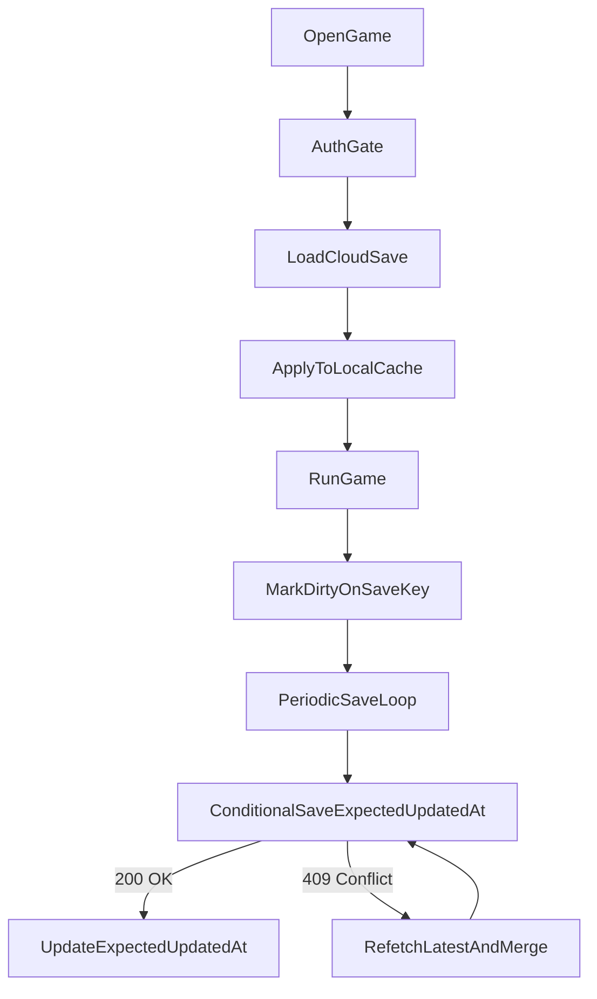
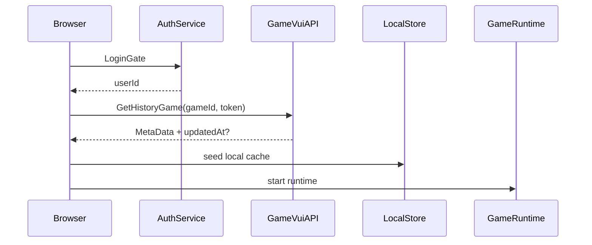
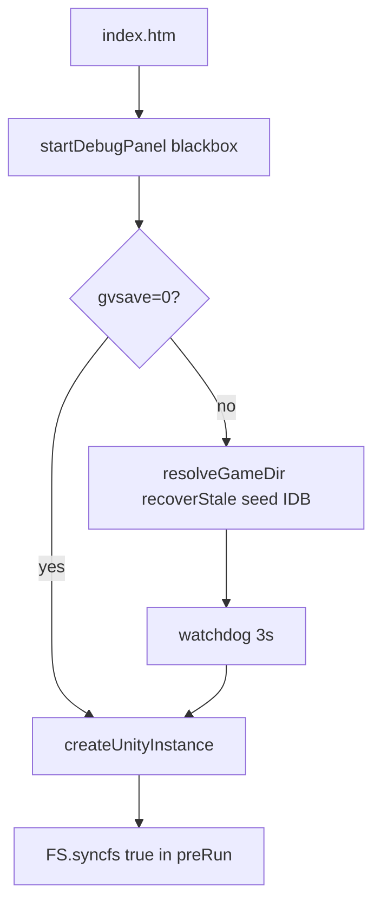
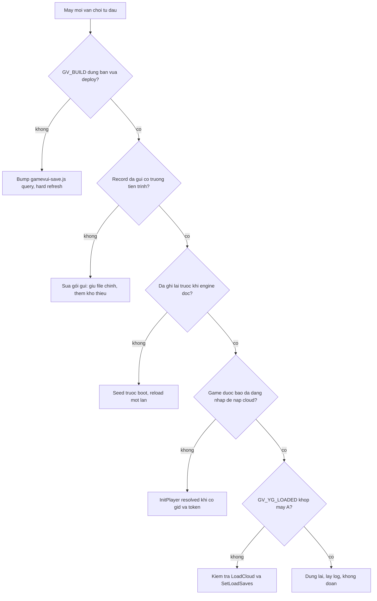

# GameVui Cloud Save - Rulebook đa game

> **Phiên bản:** 2.7  
> **Phạm vi:** Save cloud, gửi điểm, reset/xóa save, **quảng cáo nhận thưởng (`GVAdBreak`)** cho nhiều game HTML5 (Construct, Egret, Cocos, Laya, **Unity WebGL**, custom).  
> **Tài liệu nền tảng:** `save-game-architecture-knowledge.md` (overwrite-only + optimistic lock).  
> **Tài liệu này là "rulebook" chuẩn hóa để onboarding game mới, không chỉ là case study của một game cụ thể.**  
> **Changelog 2.1:** §11 bổ sung **design spec đầy đủ** nút Gửi điểm (kích cỡ, neo, font, màu, hiệu ứng) theo chuẩn Brain Out Online.  
> **Changelog 2.2:** Bài học Cocos-native UI — ưu tiên node trong scene (không DOM letterbox), chia offset theo `Top.scale`, texture/`SpriteFrame` robust, visibility theo level, hybrid nút Cocos + modal HTML; thêm §11.5.11 + case study Brain Out Online 2.  
> **Changelog 2.3:** Thêm **§21 Playbook quảng cáo nhận thưởng `GVAdBreak`**. Nút xem video (vàng/ticket/revive…) MUST gọi `GVAdBreak` rồi mới cộng thưởng native. Hook runtime theo engine (Yandex `ysdk.adv.showRewardedVideo`, Cocos `AdManager.ShowReward`, Laya `Ad.showVideoAd`) — không sửa bundle obfuscated. Localhost stub MAY grant; production không skip QC.  
> **Changelog 2.4:** Thêm **§22 Playbook Unity WebGL (IDBFS)**. Save native nằm trong IndexedDB `/idbfs`, không phải `localStorage`. Hash thư mục = MD5(directory URL) **bỏ trailing slash**. Seed cloud trước `createUnityInstance`. Cấm `store.clear()` vì origin dùng chung. Lỗi mobile khi `gvsave=0` vẫn crash là **giả thuyết chưa kết luận** (§22.9).
> **Changelog 2.5:** LayaAir **3D + physics** — không hoãn `bundle.js` sau `physics3D.js`; seed cloud bằng **native `localStorage`** trước `Laya.init` (cấm `Laya.LocalStorage` khi `_baseClass` chưa có); bọc `Laya3D.init`; case study Trang trại Mini §18.7. Playbook Toilet (hoãn bundle) không copy nguyên sang Laya 3D.
> **Changelog 2.6:** Obby tập tạ (Unity) — **IDBFS + PluginYG** cùng lúc; `GV.saveScore` = Strength/Power HUD (không phải Cup vì PNG trophy); overlay HUD `transform-origin: top left` để không clip; **§23** joystick/JUMP HTML + look-drag (`movementX` + giả pointer lock). Case study §18.8.
> **Changelog 2.8:** **§22.11 Playbook Unity xuất từ CrazyGames** — `GetDocumentURL` hardcode và SiteLock (không vá sang URL thật), ads CrazySDK sang `GVAdBreak`, `PlayerPrefs` `UnityPrf` và parse `LevelList`, load cloud an toàn (`GV_LOAD_RAW`, lỗi không flush), watchdog lớn hơn timeout cloud. Bổ sung §22.2, §22.3, §22.10, §24.9, bảng chẩn đoán và case study Vệ binh cung thủ §18.10.
> **Changelog 2.7:** **§24 Playbook save đa thiết bị: chẩn đoán trước, sửa sau** — ba kho save (IDBFS / `localStorage` / PluginYG), cây quyết định theo bằng chứng, cloud là bản chính, báo đăng nhập cho PluginYG, bảng log chuẩn, phép thử hai máy, checklist skill-ready. Case study Siêu thị đồ chơi §18.9.

---

## Mục lục

1. [Mục tiêu và nguyên tắc đọc](#1-mục-tiêu-và-nguyên-tắc-đọc)
2. [Bối cảnh hạ tầng hiện tại](#2-bối-cảnh-hạ-tầng-hiện-tại)
3. [Policy môi trường: Production vs Dev](#3-policy-môi-trường-production-vs-dev)
4. [Quy tắc bắt buộc (MUST)](#4-quy-tắc-bắt-buộc-must)
5. [Kiến trúc tổng thể](#5-kiến-trúc-tổng-thể)
6. [API contract GameVui](#6-api-contract-gamevui)
7. [Schema metadata chuẩn](#7-schema-metadata-chuẩn)
8. [Chống Lost Update (concurrency safety)](#8-chống-lost-update-concurrency-safety)
9. [Luồng khởi động game (login gate + read save)](#9-luồng-khởi-động-game-login-gate--read-save)
10. [Local cache + outbox + save loop](#10-local-cache--outbox--save-loop)
11. [Playbook gửi điểm `GV.saveScore`](#11-playbook-gửi-điểm-gvsavescore)
12. [Playbook reset/xóa save](#12-playbook-resetxóa-save)
13. [Adapter theo engine](#13-adapter-theo-engine)
14. [Onboarding game mới (Phase 0-4)](#14-onboarding-game-mới-phase-0-4)
15. [Test matrix bắt buộc trước release](#15-test-matrix-bắt-buộc-trước-release)
16. [Troubleshooting nhanh](#16-troubleshooting-nhanh)
17. [Anti-pattern cần tránh](#17-anti-pattern-cần-tránh)
18. [Phụ lục A - Case study rút gọn](#18-phụ-lục-a---case-study-rút-gọn)
19. [Phụ lục B - Lệnh grep và deploy checklist](#19-phụ-lục-b---lệnh-grep-và-deploy-checklist)
20. [Quick Start 15 phút](#20-quick-start-15-phút)
21. [Playbook quảng cáo nhận thưởng `GVAdBreak`](#21-playbook-quảng-cáo-nhận-thưởng-gvadbreak)
22. [Playbook Unity WebGL (IDBFS)](#22-playbook-unity-webgl-idbfs)
23. [Playbook Unity mobile overlay (touch + look)](#23-playbook-unity-mobile-overlay-touch--look)
24. [Playbook save đa thiết bị: chẩn đoán trước, sửa sau](#24-playbook-save-đa-thiết-bị-chẩn-đoán-trước-sửa-sau)

---

## 1. Mục tiêu và nguyên tắc đọc
  
### 1.1 Mục tiêu

- Chuẩn hóa một quy trình duy nhất để tích hợp save cloud cho nhiều game.
- Giảm sai lệch dữ liệu giữa thiết bị/tab khi cùng một tài khoản.
- Đảm bảo có playbook đầy đủ cho 4 bài toán:
  - Save/load cloud.
  - Gửi điểm (`GV.saveScore`).
  - Reset/xóa save an toàn.
  - Quảng cáo nhận thưởng (`GVAdBreak`).

### 1.2 Định nghĩa mức độ bắt buộc

- **MUST**: bắt buộc làm, không được bỏ qua.
- **SHOULD**: khuyến nghị mạnh, bỏ qua phải có lý do rõ.
- **MAY**: tùy chọn.

### 1.3 Giá trị của rulebook

- Đây là tài liệu **normative** cho đội triển khai.
- Case study chỉ dùng để minh họa, **không copy mù schema/field**.

---

## 2. Bối cảnh hạ tầng hiện tại

Hệ thống hiện tại có các ràng buộc nền tảng sau:

1. Save cloud theo mô hình **overwrite-only**.
2. Mỗi cặp `(gameId, userId)` logic chỉ có **1 dòng dữ liệu hiện hành**.
3. Không có bảng lịch sử version trên server.
4. Có trường `NgaySua`/`updatedAt` do server cập nhật mỗi lần ghi.
5. Metadata là JSON tự do (`MetaData`) nên có thể chứa field game-specific.

Hệ quả kiến trúc:

- Không thể "rollback version cũ" nếu đã ghi đè sai.
- Tâm điểm kỹ thuật là **chặn ghi đè sai trước khi ghi** (optimistic lock).
- Local chỉ là cache + write-buffer, cloud vẫn là nguồn ưu tiên.

---

## 3. Policy môi trường: Production vs Dev

### 3.1 Production (MUST)

- Bắt buộc đăng nhập trên GameVui trước khi cho phép chơi.
- Bắt buộc có `gid` + `token` hợp lệ.
- Save/load cloud là flow chính.

### 3.2 Localhost/Dev (được phép fallback)

- Nếu thiếu `gid`/`token` thì cho phép chạy local fallback để debug gameplay.
- Không được dùng kết quả localhost fallback để đánh giá cloud sync.

### 3.3 Quy tắc truyền thông trong code và log

- Log phải phân biệt rõ:
  - `No gid/token -> local fallback (dev only)`
  - `Cloud sync active (production)`

---

## 4. Quy tắc bắt buộc (MUST)

1. **Cloud-first khi load thành công**: cloud dữ liệu hợp lệ thì ghi đè local.
2. **Local là fallback**: chỉ dùng local khi cloud fail/empty hoặc dev thiếu token.
3. **Save phải có điều kiện `expectedUpdatedAt`** khi đã có dữ liệu trước đó.
4. **UPSERT phải atomic ở DB**, không tách `SELECT -> INSERT/UPDATE`.
5. **Database phải có unique constraint `(game_id, user_id)`**.
6. **`Diem` và `MetaData.totalScore` ghi cùng một request/cùng transaction**.
7. **Gặp `409 Conflict` phải refetch bản mới nhất rồi mới retry**.
8. **Không retry mù quáng với token cũ**.
9. **Reset cũng phải theo cùng cơ chế an toàn như save thường**.
10. **Xóa local sau khi wipe cloud và verify thành công** (tránh auto-restore ngược).
11. **Không copy mù field giữa các game**.
12. **Mọi thay đổi payload phải qua test matrix mục 15**.
13. **Nút xem video nhận thưởng MUST gọi `GVAdBreak` rồi mới callback cộng thưởng native** (không grant khi user đóng QC sớm trên production; localhost stub MAY grant — §21).

---

## 5. Kiến trúc tổng thể



Mô tả nhanh:

- Login gate -> load cloud -> seed local -> start runtime.
- Runtime chỉ làm việc với local/native storage như cũ.
- Adapter theo dõi thay đổi save key để mark `dirty`.
- Save loop đẩy cloud theo chu kỳ + flush khi ẩn tab/đóng trang.
- Conflict được xử lý bằng refetch + merge rule.

---

## 6. API contract GameVui

### 6.1 Endpoint

| Hành động | Method | URL |
|---|---|---|
| Load save | `POST` | `https://gamevui.vn/account/GetHistoryGame` |
| Save save | `POST` | `https://gamevui.vn/account/SaveHistoryGame` |

### 6.2 Request cơ bản

- `Content-Type`: `application/x-www-form-urlencoded; charset=UTF-8`
- `credentials`: `include`
- Params:
  - `gameId` (từ `gid`)
  - `token` (từ query)
  - `metadata` (JSON string, với save)

### 6.3 Contract mở rộng cho concurrency (MUST cho rollout đa thiết bị)

Để đúng mô hình overwrite-only trên nhiều thiết bị, backend **MUST** hỗ trợ:

- Input thêm `expectedUpdatedAt` (null nếu lần ghi đầu).
- Nếu không khớp `updatedAt` hiện tại -> trả `409 Conflict`.
- Trả `updatedAt` mới trong response save thành công.

> Nếu endpoint hiện tại chưa hỗ trợ `expectedUpdatedAt`, phải mở ticket backend và nâng cấp trước khi rollout đồng bộ đa thiết bị quy mô lớn.

### 6.4 Response handling

- `GetHistoryGame`: `MetaData` có thể là string JSON hoặc object.
- Save thành công: cần đọc token `updatedAt` mới.
- Save conflict: branch xử lý riêng, không xem là network error.

---

## 7. Schema metadata chuẩn

### 7.1 Field bắt buộc toàn hệ

```json
{
  "CurrentLevel": 0,
  "TotalScore": 0,
  "CurrentStage": 0,
  "SavedAt": "2026-08-01T08:00:00.000Z"
}
```

| Field | Type | Rule |
|---|---|---|
| `CurrentLevel` | number | Level cao nhất đã qua; không có khớp nghĩa thì `0` |
| `TotalScore` | number | Tổng điểm tích lũy; không có thì `0` |
| `CurrentStage` | number | Stage/wave theo nghĩa platform; không khớp nghĩa thì `0` |
| `SavedAt` | string ISO | Set mỗi lần push save |

### 7.2 Field game-specific

Nguyên tắc:

- Chỉ thêm field nếu game native có dữ liệu tương ứng.
- Không copy field của game A sang game B nếu khác nghĩa.
- Hai mô hình chính:
  - **Key-rời**: map từng key (`Currency`, `UnlockedLevel`, ...).
  - **Blob**: lưu nguyên record (`Record`) và restore atomic.

### 7.3 Quy tắc map an toàn

1. Có bằng chứng rõ ràng trong save native mới map sang field bắt buộc.
2. Không chắc nghĩa -> để `0`.
3. Rule hay dùng:
   - `CurrentLevel = max(0, UnlockedLevel - 1)` khi unlock tuần tự.
4. `TotalScore` và cột điểm server phải đồng bộ cùng lần ghi.

---

## 8. Chống Lost Update (concurrency safety)

### 8.1 Vấn đề

Hai thiết bị cùng đọc cùng một bản save.  
Thiết bị B save trước, thiết bị A save sau với dữ liệu cũ -> dễ mất tiến trình của B.

Trong mô hình overwrite-only, lỗi này rất nguy hiểm vì không có lịch sử để khôi phục.

### 8.2 Cơ chế chống

Save phải có điều kiện token:

```sql
UPDATE saves
SET score = :newScore,
    metadata = :newMetadataJson,
    updated_at = NOW()
WHERE game_id = :gameId
  AND user_id = :userId
  AND updated_at = :expectedUpdatedAt;
```

- `rowsAffected = 1`: save thành công.
- `rowsAffected = 0`: conflict -> trả `409`.

### 8.3 Lần ghi đầu tiên

- Dùng atomic UPSERT + unique `(game_id, user_id)`.
- Không dùng pattern 2 bước "kiểm tra tồn tại rồi mới ghi".

### 8.4 Pseudocode client

```typescript
type SaveResult =
  | { ok: true; updatedAt: string }
  | { ok: false; reason: "conflict" | "network" | "auth" };

async function pushSave(payload: SavePayload, expectedUpdatedAt: string | null): Promise<SaveResult> {
  try {
    const res = await api.saveHistoryGame({
      metadata: payload,
      expectedUpdatedAt
    });

    if (res.status === 409) return { ok: false, reason: "conflict" };
    if (!res.ok) return { ok: false, reason: "auth" };
    return { ok: true, updatedAt: res.data.updatedAt };
  } catch {
    return { ok: false, reason: "network" };
  }
}
```

### 8.5 Merge rule khi conflict

| Nhóm field | Rule |
|---|---|
| Tiến trình tuyến tính (`CurrentLevel`, `CurrentStage`) | `Math.max()` |
| Điểm tổng (`TotalScore`) | `Math.max()` (không cộng dồn) |
| Tập vật phẩm (nếu có) | Union/merge theo key không mất item |
| Blob lớn (`Record`) | ưu tiên bản mới nhất + patch field an toàn nếu game cho phép |

---

## 9. Luồng khởi động game (login gate + read save)



### 9.1 Quy tắc startup

1. `init()` phải xong trước runtime start (`cr_createRuntime` / `egret.runEgret` / `window.boot`).
2. Timeout load cloud ~5s để fail-open nếu mạng chậm.
3. Nếu load fail -> cho game boot với local fallback.
4. Không để splash treo vì chờ vô hạn API.

---

## 10. Local cache + outbox + save loop

### 10.1 Vai trò local

- Đọc nhanh cho runtime.
- Giữ dữ liệu pending khi mất mạng.

### 10.2 State tối thiểu cần lưu local

```typescript
interface LocalSyncState {
  payload: SavePayload;
  expectedUpdatedAt: string | null;
  dirty: boolean;
  pendingOutbox: SavePayload[];
}
```

### 10.3 Save loop chuẩn

- **10 giây** nếu `dirty` -> push cloud.
- Fail network -> retry ~1 giây, giữ outbox.
- `visibilitychange`/`pagehide` -> flush best-effort.

### 10.4 Trigger dirty

- Bắt tại native save key (setItem/WebStorage), không phụ thuộc event UI.
- Ví dụ:
  - Construct: `StoreLocal` / plugin WebStorage.
  - Egret: `egret.localStorage.setItem`.
  - Cocos: `record_game70001`.

---

## 11. Playbook gửi điểm `GV.saveScore`

### 11.1 Mục tiêu

- Thêm nút HTML overlay **"Gửi điểm"** theo **design spec §11.5** (giống chuẩn Brain Out Online).
- Click -> `new GV().saveScore(n)`.
- Flow gửi điểm là **fire-and-forget**: không mở popup/toast/alert khi bấm gửi.
- Nếu thiếu `GV`/`GV.saveScore`: bỏ qua im lặng, không crash.

### 11.2 Dependency

```html
<script src="//www.gamevui.com/games/services/score.min.js?fullscreen=0"></script>
```

- File tích hợp save cloud dùng tên chuẩn: `gamevui-save.js` (nếu game có cloud save).

### 11.3 Rule chọn giá trị `n`

- Puzzle/unlock game: có thể là `CurrentLevel`.
- Score-based game: high score hiện tại.
- Stage game: stage cao nhất.
- Unity gym / obby / tap-tạ: `n` = số HUD **tăng +1 mỗi tap** nâng tạ (Strength/Power hiện tại), **không** phải Cup/trophy.

`n` là quyết định theo game design, **không có công thức cứng cho mọi game**. Tách hàm `getScoreToSend()` và tự implement.

Unity / blob save (MUST khi không có field C# rõ):

- Walk YG `SaveCloud` JSON + PlayerPrefs ASCII/JSON. Key ưu tiên: `strength`, `power`, `muscle` (kể cả `currentStrength` / `CurrentPower`).
- MUST NOT lấy Cup chỉ vì nút dùng PNG trophy (§11.4) — icon là UI GameVui, không phải nghĩa `n`.
- MUST skip stem `best` / `max` / `high` / `record` (highscore) và `powerPreference` / `horsepower` / `cost` / `price` / `require`.
- Dump `Build/*.data.br` thường **không** có Node/Brotli trên máy deploy — đừng chặn onboarding vì không grep wasm. Walk save runtime đủ.

### 11.4 Asset

| Rule | Chi tiết |
|------|----------|
| **MUST** | Tự đặt file **`save-score.png`** **cùng cấp** entry HTML (`index.htm` / `index.html`). |
| Tên file | Cố định: `save-score.png`. |
| Nội dung ảnh | Trophy vàng, sao đỏ giữa cup, viền đen đậm, nền đen (không có chữ trong PNG). |
| Kích thước nguồn | Thường **256×256** (vuông). |

### 11.5 Design spec UI (MUST — chuẩn Brain Out)

Thiết kế nút ở mọi game **MUST** khớp bảng dưới (trừ mục ghi **MAY**).

#### 11.5.1 Cấu trúc visual

```
┌─────────────┐
│  [trophy]   │  ← ảnh save-score.png
│  Gửi điểm   │  ← text HTML bên dưới icon
└─────────────┘
```

- Layout: `flex-direction: column`; `align-items: center`; `gap: 2px`.
- Chữ **MUST** là `"Gửi điểm"` (không nhét chữ vào PNG).

#### 11.5.2 Kích cỡ và spacing (design space trước khi scale)

| Phần | Giá trị chuẩn |
|------|----------------|
| Icon hiển thị | `width: 70px`; `height: 60px`; `object-fit: contain` |
| Font size chữ | `18px` |
| Font weight | `700` |
| Line height | `1.2` |
| Padding nút | `4px 6px` |
| Gap icon–chữ | `2px` |

Toàn bộ khối được **scale theo canvas** (`s = canvasWidth / designWidth`) nên trên màn lớn/nhỏ vẫn tỷ lệ đúng.

#### 11.5.3 Màu sắc

| Phần | Giá trị |
|------|---------|
| Nền nút | `transparent` (không box tối) |
| Border nút | `none` |
| Màu chữ | `#000` |
| Text shadow | `0 1px 2px rgba(254, 254, 254, 0.8)` (chữ dễ đọc trên nền sáng/tối) |
| Icon | Theo PNG (vàng / đỏ / đen) — không đổi filter trừ khi design game yêu cầu |

#### 11.5.4 Font (MUST — không CDN)

```css
font-family: "Comic Sans MS", "Chalkboard SE", "Marker Felt", "Segoe UI", Tahoma, sans-serif;
```

- Windows: Comic Sans MS.
- Apple fallback: Chalkboard SE / Marker Felt.
- Fallback an toàn tiếng Việt: Segoe UI / Tahoma.

#### 11.5.5 Vị trí neo (bám vùng game)

| Rule | Chi tiết |
|------|----------|
| **MUST (DOM — Egret/Construct)** | Neo theo **vùng game thật** = `canvas.getBoundingClientRect()` (hoặc container render tương đương), **không** góc letterbox / full viewport. |
| **Cocos Native (MUST khi có letterbox/showAll)** | Render nút Save/Reset thành **node trong Canvas/scene** (không dùng DOM overlay làm neo chính). DOM dễ lệch ra vùng đen dù đã dùng `getBoundingClientRect` / `cc.view.getViewportRect()`. |
| **Cocos HUD Top (SHOULD)** | Nếu scene có cụm HUD `Canvas/LevelX/Top`, mount action vào `Top`. Offset tính theo **level design-space**, rồi **chia theo `Top.scaleX/Y`** trước khi `setPosition` (xem công thức dưới). |
| **Cocos DOM fallback (MAY)** | Chỉ khi chưa chuyển Cocos-native: detect hệ tọa độ `getViewportRect`, validate, fallback DOM rect, giữ `lastGoodRect`. Đây là legacy — không khuyến nghị cho game mới. |
| Mặc định (Brain Out Egret) | Góc trên **phải** trong canvas; `pad = 8 * s`. |
| **MAY** | Đổi góc (dưới-trái, trên-trái, …) cho khớp HUD từng game — vẫn **MUST** bám vùng gameplay. |
| Scale (DOM) | Wrap: `transform: scale(s)` với `s = rect.width / designWidth`. |
| `designWidth` | = content width native game (Brain Out Egret: **640**; Brain Out Cocos 2: **480**; Construct thường 1280/1920). |
| `transform-origin` | Mặc định `top right` khi neo góc phải **và không scale lệch khỏi cạnh**. Unity overlay scale (`s = shortSide / 720`): **MUST `top left`** + `overflow: visible`. Origin `right` / `center` khi `s < 1` đẩy icon **ra ngoài canvas**. |

**Unity DOM overlay (Obby tập tạ, SHOULD khi HUD luôn hiện):**

- Neo `#unity-canvas` (`getBoundingClientRect`), `burstSync` như DOM §11.5.5.
- MAY icon-only (không span `"Gửi điểm"` / `"Xóa dữ liệu"`) — vẫn MUST `title` / `aria-label`.
- MAY neo **giữa cạnh phải** canvas (`top ≈ rect.top + rect.height/2`), `pad ≈ 14`.
- `isGvUiEvent` / `FocusGame` MUST bỏ qua `#gv-hud-actions`, `#gv-reset-modal`, `#gv-touch-layer` — không cướp pointer của overlay.

**Cocos — công thức vị trí khi parent là `Top` (scale thường ≠ 1, vd. ~0.601):**

```javascript
// Margin = đơn vị level design-space (vd. canvas 480×800), KHÔNG phải đơn vị thô của Top.
var scaleTopX = Math.abs(topNode.scaleX) > 0.0001 ? topNode.scaleX : 1;
var scaleTopY = Math.abs(topNode.scaleY) > 0.0001 ? topNode.scaleY : 1;
var posX = ((-levelW / 2 + leftMargin) - topX) / scaleTopX;
var posY = ((-levelH / 2 + bottomMargin) - topY) / scaleTopY;
groupNode.setPosition(posX, posY);
// Icon giữ kích thước visual ổn định:
groupNode.setScale(desiredScale / Math.abs(scaleTopX), desiredScale / Math.abs(scaleTopY));
```

- Nếu **không** chia theo `Top.scale`, mọi thay đổi `leftMargin`/`bottomMargin` chỉ còn ~60% hiệu ứng → cảm giác “chỉnh không ăn”.
- Clamp nhẹ để giữ trong vùng playable; **không** lock X/Y theo sibling HUD (`fh`/`pf`/…) trừ khi design bắt buộc bám đúng nút đó (lock sibling làm margin “đứng yên”).
- Resync Cocos: `burstSync` (~400ms) + hook `cc.view.setResizeCallback` (hoặc event `gv-engine-resize`) vì engine layout trễ sau resize/fullscreen.

Nếu dùng biến cấu hình trong `gamevui-save.js` (Cocos native), chỉnh nhanh như sau (đơn vị = level design-space **480×800**; đã chia `Top.scale` nên 1 đơn vị ≈ 1 px design):

- `leftMargin`: tăng → sang phải; giảm → sang trái.
- `bottomMargin`: tăng → lên trên; giảm → xuống dưới.
- `spacing`: tăng → 2 nút xa hơn; giảm → sát hơn.
- Bước tinh chỉnh khuyến nghị: **6–12** đơn vị mỗi lần.

**DOM — công thức mặc định (góc trên phải, Egret/Construct):**

```javascript
wrap.style.top  = Math.round(rect.top + 8 * s) + "px";
wrap.style.left = Math.round(rect.right - 8 * s - wrap.offsetWidth) + "px";
wrap.style.transform = "scale(" + s + ")";
```

Resync DOM **MUST** khi: `resize`, `orientationchange`, `fullscreenchange` (+ webkit/moz/MS), `visualViewport` resize/scroll, `ResizeObserver` trên player/canvas. Dùng **burst** `requestAnimationFrame` ~400ms.

#### 11.5.6 DOM tách lớp (MUST)

| Element | Vai trò |
|---------|---------|
| `#gv-send-score-wrap` | `position: fixed`; neo top/left; `scale`; `pointer-events: none`; anti-select |
| `#gv-send-score-btn` | `pointer-events: auto`; layout cột; hover `translateY` (không gộp scale lên cùng node) |

Tách wrap/button để **scale** và **hover lift** không xung đột transform.

#### 11.5.7 Hiệu ứng tương tác

| Trạng thái | Hiệu ứng |
|------------|----------|
| Default | `transform: translateY(0)` |
| `:hover` | `translateY(-5px)` — nổi nhẹ |
| `:active` | `translateY(-2px)` + `opacity: 0.9` |
| Transition | `transform 0.22s ease` (thả chuột chìm mượt về chỗ cũ) |
| Tap highlight | `-webkit-tap-highlight-color: transparent` |

#### 11.5.8 Anti-select / anti-drag (MUST)

- `user-select: none` (+ vendor) trên wrap, button, img, span.
- `img { pointer-events: none; -webkit-user-drag: none; }`.
- `draggable="false"` trên ``.
- Chặn `selectstart` / `dragstart` trên button nếu cần.

#### 11.5.9 Behavior click

```javascript
new GV().saveScore(getScoreToSend());
```

- Không toast / alert / popup.
- Thiếu `GV` → warn console (MAY), không crash.

#### 11.5.10 Variant cartoon cho cặp nút Save/Reset (SHOULD)

Áp dụng cho game cần UI nổi bật hơn (ví dụ Brain Out clone) nhưng vẫn giữ đúng hành vi rulebook.

- Placement: cụm nút ở góc dưới trái vùng gameplay, tránh chồng watermark/logo; màn hẹp thì tự đẩy cụm nút lên thêm 12–28px.
- Visibility (Brain Out Cocos): chỉ hiện khi đang ở scene gameplay `Canvas/LevelN` active; ẩn ở màn trang chủ/menu.
- Anchor (Brain Out Cocos): **MUST** dùng Cocos-native node dưới `Canvas/LevelN/Top` (§11.5.5 + §11.5.11). Neo DOM theo `#Cocos2dGameContainer` / `#GameCanvas` chỉ còn là **legacy fallback** khi chưa chuyển native.
- Visual: mỗi action là icon + label; MAY thêm "card" bo góc/viền/shadow nếu cần nổi hơn. Khi cần giảm che gameplay: bỏ card ngoài, giữ icon + label.
- Label bắt buộc: `Gửi điểm`, `Xóa dữ liệu` (không nhét text trong PNG).
- Readability:
  - Font comic stack (`"Comic Sans MS", "Chalkboard SE", "Marker Felt", cursive`).
  - Tương phản chữ với nền >= mức đọc rõ trên mobile.
  - Giữ cỡ chữ đã scale tối thiểu ~13px.
- Accessibility cơ bản:
  - Button có `title`/`aria-label` (DOM) hoặc tên node rõ ràng (Cocos).
  - Vùng bấm thực tế tối thiểu xấp xỉ 44x44px sau scale.
  - Trạng thái `disabled` của reset phải nhìn thấy rõ (opacity/cursor/text đổi trạng thái).
- Reset modal vẫn theo chuẩn mục 12.4 (nút xác nhận đỏ, nút hủy xanh), chỉ thay skin cartoon — modal **MAY** giữ HTML dù nút là Cocos-native.

#### 11.5.11 Playbook Cocos-native Save/Reset (SHOULD)

Checklist triển khai cho game Cocos Creator 2.x (rút từ Brain Out Online 2):

1. **Parent HUD:** mount group node vào `Canvas/LevelN/Top` (hoặc HUD tương đương). Đặt `zIndex` cao để không bị gameplay che.
2. **Visibility:** poll/sync theo level active (`cc.find("Canvas/Level" + n)`); ẩn khi không có level play (menu/home).
3. **Vị trí:** dùng công thức chia `Top.scale` ở §11.5.5; config `leftMargin` / `bottomMargin` / `spacing` / `buttonSize` bằng design-space.
4. **Texture icon:**
   - Đặt `save-score.png` / `reset-data.png` cùng cấp entry HTML.
   - Load qua `cc.loader` / `cc.textureCache` với nhiều candidate URL (`./file`, `file`, `/path/file`).
   - Chuẩn hóa input thành `cc.Texture2D` rồi tạo `cc.SpriteFrame`.
   - Sprite dùng `SizeMode.CUSTOM` + `setContentSize` sau khi gán frame (tránh icon tự scale lệch / mất ảnh).
5. **Lifecycle:** chỉ tạo/bind node khi scene sẵn sàng (`cc.director` + scene hợp lệ) — tránh lỗi đỏ `schedule` / `_owner`.
6. **Tương tác:** touch scale nhẹ trên node; gửi điểm silent (§11.5.9); reset mở modal HTML (mục 12.4) rồi wipe → verify → clear local → reload.
7. **Resync:** `burstSync` + hook resize engine; re-parent khi đổi level/`Top`.
8. **Hybrid OK:** nút = Cocos-native; confirm reset = HTML modal — không bắt buộc modal cũng là Cocos node.

### 11.6 HTML / CSS mẫu (copy chuẩn)

```html
<div id="gv-send-score-wrap">
  <button type="button" id="gv-send-score-btn" title="Gửi điểm" aria-label="Gửi điểm">
    
    <span>Gửi điểm</span>
  </button>
</div>
```

Đặt wrap **trong** container game (vd. `.egret-player`, `#c2canvasdiv`, root Cocos canvas parent).

```css
#gv-send-score-wrap {
  position: fixed;
  top: 0;
  left: 0;
  z-index: 9999;
  display: none;
  transform-origin: top right;
  pointer-events: none;
  user-select: none;
  -webkit-user-select: none;
  -moz-user-select: none;
  -ms-user-select: none;
  -webkit-touch-callout: none;
}

#gv-send-score-btn {
  pointer-events: auto;
  display: flex;
  flex-direction: column;
  align-items: center;
  gap: 2px;
  padding: 4px 6px;
  border: none;
  background: transparent;
  border-radius: 8px;
  cursor: pointer;
  -webkit-tap-highlight-color: transparent;
  font-family: "Comic Sans MS", "Chalkboard SE", "Marker Felt", "Segoe UI", Tahoma, sans-serif;
  color: #000;
  font-size: 18px;
  font-weight: 700;
  line-height: 1.2;
  text-shadow: 0 1px 2px rgba(254, 254, 254, 0.8);
  user-select: none;
  -webkit-user-select: none;
  transition: transform 0.22s ease;
  transform: translateY(0);
}

#gv-send-score-btn:hover { transform: translateY(-5px); }
#gv-send-score-btn:active { transform: translateY(-2px); opacity: 0.9; }

#gv-send-score-btn img,
#gv-send-score-btn span {
  user-select: none;
  -webkit-user-select: none;
  -webkit-touch-callout: none;
}

#gv-send-score-btn img {
  width: 70px;
  height: 60px;
  display: block;
  object-fit: contain;
  pointer-events: none;
  -webkit-user-drag: none;
}
```

### 11.7 JS neo + click (mẫu)

```javascript
var DESIGN_WIDTH = 640; // đổi theo content width native của game
var GAME_ROOT = document.querySelector(".egret-player"); // Construct: "#c2canvasdiv" | Cocos: parent của canvas

function findGameCanvas() {
  return GAME_ROOT ? GAME_ROOT.querySelector("canvas") : null;
}

function getScoreToSend() {
  // TODO: tùy game — điểm số, level, CurrentLevel, ...
  // Ví dụ Brain Out: return GamevuiSave.getLocalSnapshot().CurrentLevel || 0;
  return 0;
}

function onSendScoreClick(e) {
  if (e) { e.preventDefault(); e.stopPropagation(); }
  var n = getScoreToSend();
  try {
    if (typeof GV !== "undefined") new GV().saveScore(n);
  } catch (err) { /* ignore */ }
}

function syncSendScoreBtnPosition() {
  var wrap = document.getElementById("gv-send-score-wrap");
  var canvas = findGameCanvas();
  if (!wrap || !canvas) { if (wrap) wrap.style.display = "none"; return; }
  var rect = canvas.getBoundingClientRect();
  if (!rect.width) { wrap.style.display = "none"; return; }
  var s = rect.width / DESIGN_WIDTH;
  wrap.style.display = "block";
  wrap.style.transform = "scale(" + s + ")";
  var pad = 8 * s;
  wrap.style.top = Math.round(rect.top + pad) + "px";
  wrap.style.left = Math.round(rect.right - pad - wrap.offsetWidth) + "px";
}

// Gọi startAnchoring() sau khi runtime tạo canvas;
// onLayoutChange -> burstSync(400) trên resize / fullscreen / visualViewport / ResizeObserver.
```

**Egret:** `startAnchoring()` ngay sau `egret.runEgret(...)`.  
**Construct / Cocos / custom:** đổi `GAME_ROOT`, `DESIGN_WIDTH`, `transform-origin` theo góc neo.

### 11.8 Checklist triển khai

- [ ] Đặt `save-score.png` cùng cấp entry HTML.
- [ ] DOM wrap + button đúng id; chữ "Gửi điểm" dưới icon.
- [ ] CSS khớp §11.5 (size 70×60, font 18/700, màu #000 + shadow, Comic Sans stack).
- [ ] Hover nổi / active / transition đúng.
- [ ] Anti-select + không kéo ảnh.
- [ ] Neo theo canvas; mặc định góc trên phải (hoặc góc đã chọn vẫn bám game).
- [ ] `designWidth` đúng; burst sync khi resize/fullscreen.
- [ ] Implement `getScoreToSend()` đúng nghĩa game.
- [ ] Thiếu `GV` không crash; không toast khi gửi.

### 11.9 Reference

- Triển khai mẫu: [`index.htm`](index.htm) (Brain Out Online).
- Case study: [§18.2](#182-brain-out-online-egret).

---

## 12. Playbook reset/xóa save

### 12.1 Mục tiêu

- Chơi lại từ đầu trên mọi thiết bị.
- Không để local cũ auto-đẩy ngược lên cloud sau reset.

### 12.2 Trường hợp chưa có Delete API riêng

Wipe bằng `SaveHistoryGame` với metadata reset.  
Mẫu cho game blob:

```json
{
  "CurrentLevel": 0,
  "TotalScore": 0,
  "CurrentStage": 0,
  "SavedAt": "2026-08-01T08:30:00.000Z",
  "Record": { "__version__": 1 }
}
```

Rule bắt buộc:

1. `SaveHistoryGame` wipe.
2. `GetHistoryGame` verify đã wipe.
3. Mới `removeItem` local key liên quan.
4. Chặn `setItem` trong trạng thái `resetting`.
5. Hard reload (`location.replace` với token `_gv=`).
6. Nếu không có `gid/token`: chỉ reset local về default (`Record: { "__version__": 1 }`) + cảnh báo local-only, không báo thành công cloud.

### 12.3 Trường hợp đã có Delete API riêng

- Vẫn giữ nguyên flow an toàn:
  - Delete cloud -> verify -> clear local -> reload.
- Không bỏ qua verify.

### 12.4 UI xác nhận (MUST)

Nội dung:

```
Bạn có chắc chắn xóa không?
Mọi dữ liệu sẽ bị xóa vĩnh viễn và không thể khôi phục.
```

- Nút `Xác nhận`: màu đỏ.
- Nút `Hủy`: màu xanh.
- Nên dùng HTML overlay để kiểm soát UX nhất quán.

### 12.5 Retry strategy

- Save/verify fail -> retry tối đa 3 lần.
- Quá ngưỡng -> thông báo lỗi, **không clear local, không reload**.
- Cho phép fallback 1 lần sang payload default sạch khi nhánh wipe chính thất bại, rồi verify lại.

### 12.6 No-token behavior (localhost/dev)

- Marker: `GV_SYNC_LOCAL_ONLY`.
- Khi bấm reset mà thiếu `gid/token`:
  - ghi local về default sạch,
  - cảnh báo rõ “local-only, chưa đồng bộ cloud”,
  - reload để vào game với trạng thái mới.
- Marker hoàn tất: `GV_RESET_LOCAL_ONLY`.

---

## 13. Adapter theo engine

### 13.1 Construct 2/3

- Patch WebStorage plugin thay vì sửa `data.js`.
- Await `init()` trước `cr_createRuntime`.
- Xác định đúng unlock/save key.

### 13.2 Egret

- Patch `egret.localStorage.setItem`.
- Seed cloud trước `egret.runEgret`.
- Không sửa bundle minified nếu không bắt buộc.

### 13.3 Cocos Creator 2.x

- Patch `window.localStorage`/`cc.sys.localStorage`.
- Game blob: ưu tiên lưu/restore field `Record` (khi game dùng blob).
- Có sanitize + giới hạn kích thước blob để tránh treo.
- **UI Save/Reset (SHOULD):** Cocos-native node dưới HUD (`Canvas/LevelN/Top`), **không** DOM overlay khi có letterbox/showAll — xem §11.5.5 + §11.5.11.
- Vị trí: chia offset theo `Top.scaleX/Y`; margin = level design-space.
- Lifecycle: đợi scene ready trước khi tạo node; burst resync khi resize/fullscreen.
- Hybrid: nút Cocos-native + modal reset HTML (mục 12.4) là hợp lệ.

### 13.4 Custom / LayaAir

- Viết adapter storage riêng.
- Giữ nguyên rule cloud-first, optimistic lock, reset flow.
- **Survey save native (MUST):** một blob (`jkrdz_json_*`) **hoặc** nhiều key rời (`LGD_` / `BBH_` / `PBH_` / `TOURIST_ACCOUNT` / `GuideString2` / …). Nhiều key → payload `Record.keys` map `key → string`.
- **Boot Laya 3D + `physics3D.js` (MUST):** `index.js` load tuần tự `laya.physics3D.js` → `gamevui-save.js` → `js/bundle.js`. MUST NOT `loadLib("js/bundle.js")` từ `Promise.then` sau khi physics đã chạy — `Laya3D.init` lệch hàng script → `Scene3D.load` callback `undefined` → crash `e.zOrder` (`onScene3dLoaded`) lúc “Loading model”.
- **Seed cloud (MUST):** bọc `window.Laya3D.init`: `await GetHistoryGame` (timeout ~5s fail-open) rồi gọi `init` gốc. Cloud-first trước `initMain` / `loadGameData`.
- **Ghi local khi seed (MUST):** dùng `window.localStorage` native (`origSetItem` / `origRemoveItem`). MUST NOT gọi `Laya.LocalStorage.setItem` / `removeItem` / `getItem` trước `Laya.init` — `LocalStorage.__init__` gán `_baseClass` và `Storage.items` chỉ trong `Laya.init` (`laya.core.js`, `supportLocalStorage = jt.__init__()`). Triệu chứng giả: log `GetHistoryGame failed` + `Cannot read properties of undefined (reading 'removeItem')` trong khi API đã 200; sau đó `GV_SAVE_OK` vẫn chạy vì engine đã init. `withTimeout` nuốt exception apply → **không** kết luận API load hỏng.
- **UI overlay reset (MUST):** `bindActionUi` / `ResizeObserver` canvas **sau** `Laya3D.init` gốc trả về. MUST NOT poll/observe canvas trước WebGL.
- Playbook Toilet Vs Camera (hoãn `bundle.js` rồi seed, patch `Laya.LocalStorage`) chỉ an toàn khi **không** phụ thuộc `Laya3D.init` ngay sau `physics3D.js` (2D / FairyGUI). MUST NOT copy nguyên sang Laya 3D + physics.
- **Rewarded ads (MUST khi game có nút xem QC):** patch runtime, không sửa `bundle.js` / SDK minified.
  - Yandex H5: shim `window.ysdk.adv.showRewardedVideo` → `GVAdBreak` rồi defer `onRewarded` + `onClose` (game tự cộng vàng/ticket). Trap `window.ysdk` setter để bundle không ghi đè.
  - Interstitial: MUST stub `ysdk.adv.showFullscreenAdv` (`onClose(false)`, **không** `GVAdBreak`) — nếu chỉ shim rewarded thì nút claim thường crash (`showFullscreenBegin` / `ShowIns`).
  - Rating: MUST stub `ysdk.feedback.canReview` / `requestReview` (resolve `false`) và `getPlayer` — thắng màn gọi `ShowRating` chỉ check `window.ysdk`, thiếu `feedback` → crash `canReview`.
  - Channel SDK: wrap `Ad.showVideoAd` / `mainCH.showVideoAd` cùng pattern.
  - Cài shim **trước** khi load bundle để game không đi nhánh “không có SDK → thưởng miễn phí”.
  - Marker: `GV_AD_REWARD_PATCHED`. Chi tiết §21.

### 13.5 Unity WebGL

- Save native = IndexedDB `/idbfs` (Emscripten IDBFS), **không** `localStorage`.
- Seed cloud vào đúng `/idbfs/<MD5(directory URL)>` **trước** `createUnityInstance` — Unity chỉ `FS.syncfs(true)` trong `preRun`.
- PluginYG: **chỉ wrap** `SaveCloud` / `LoadCloud` / `SetLoadSaves` khi survey thấy game gọi (log `SaveCloud`, không chỉ stub `player == null`). Có kênh đó thì vẫn MUST seed IDBFS — hai kênh, không thay thế nhau. Cặp đôi Anime = IDBFS-only; Obby tập tạ = IDBFS + wrap YG.
- MUST không sửa `game.js`, wasm, `Build/*.unityweb`.
- MUST scoped theo thư mục game: mọi Unity game trên gamevui.vn chung một origin / một DB `/idbfs`.
- Overlay mobile (joystick / look): **§23**. Chi tiết save: **§22**.

---

## 14. Onboarding game mới (Phase 0-4)

### Phase 0 - Survey (bắt buộc)

- [ ] Mở file save thật đã gửi và chỉ ra trường tiến trình nằm ở kho nào (IDBFS / `localStorage` / PluginYG). Chưa biết kho thì không code khôi phục (§24.1, §24.2).
- [ ] Xác định engine.
- [ ] Tìm cơ chế save native.
- [ ] Liệt kê key prefix + key quan trọng.
- [ ] Tìm hook save và load startup.
- [ ] Chốt mapping metadata.
- [ ] Chốt điểm gắn nút gửi điểm (nếu có).
- [ ] Đánh giá cần reset feature không.
- [ ] Liệt kê nút xem video nhận thưởng + API ad native (Yandex / channel / custom).

Output mẫu:

```markdown
## Survey: Tên game
- Engine:
- Save model: key-rời/blob
- Key prefix:
- Unlock/save trigger:
- Mapping CurrentLevel/TotalScore/CurrentStage:
- Game-specific fields:
- Score send rule:
- Reset strategy:
```

### Phase 1 - Adapter và mapping

- Copy/cấu hình `gamevui-save.js`.
- Implement convert 2 chiều:
  - local -> metadata
  - metadata -> local

### Phase 2 - Wire startup

- Đảm bảo thứ tự script đúng.
- `init()` trước runtime start.
- Bật periodic save + pagehide flush.

### Phase 3 - Reset + score (nếu bắt buộc)

- Thêm reset UI + flow verify.
- Thêm nút gửi điểm + `getScoreToSend()`.

### Phase 4 - Test + deploy

- Chạy test matrix mục 15.
- Deploy + cache bust.
- Verify trên PC và mobile.

---

## 15. Test matrix bắt buộc trước release

### 15.1 Core save/load

- [ ] Có cloud save sẵn: load đúng cloud, overwrite local.
- [ ] User mới không save: không crash, default/fallback đúng.
- [ ] Qua màn hoặc đổi progress: `dirty` được bật.
- [ ] Save loop 10s hoạt động, không spam.

### 15.2 Reliability

- [ ] Mất mạng khi save: queue pending + retry.
- [ ] Đóng/mở tab lại: data không mất bất thường.
- [ ] `pagehide` flush hoạt động.

### 15.3 Cross-device

- [ ] Save ở PC, mở mobile cùng account -> dữ liệu đồng bộ đúng.
- [ ] Conflict test 2 tab/thiết bị -> không mất tiến trình mới hơn.

### 15.4 Reset

- [ ] Xác nhận reset UI đúng copy/màu.
- [ ] Wipe cloud + verify + clear local + reload đúng thứ tự.
- [ ] Save/verify fail -> không xóa local, không reload.
- [ ] Thiếu `gid/token` -> reset local-only + cảnh báo đúng + reload không treo.
- [ ] Có marker phân biệt nhánh reset (`GV_RESET_CLOUD_VERIFIED` / `GV_RESET_FALLBACK_DEFAULT` / `GV_RESET_LOCAL_ONLY`).

### 15.5 Gửi điểm

- [ ] Nút đúng layout: icon trên + chữ "Gửi điểm" dưới (§11.5).
- [ ] Size icon 70×60, font 18/700, Comic Sans stack, màu #000 + text-shadow.
- [ ] Nằm trong vùng canvas (không letterbox); mặc định góc trên phải hoặc góc đã chọn vẫn bám game.
- [ ] Resize/fullscreen/orientation vẫn canh đúng (burst sync).
- [ ] Hover nổi / thả chìm mượt; không bôi đen / kéo ảnh.
- [ ] `GV.saveScore(n)` nhận đúng `n` theo game design.
- [ ] Thiếu `GV` không crash; không toast/popup khi gửi.

### 15.6 Quảng cáo nhận thưởng (`GVAdBreak`)

- [ ] Mọi nút xem video (vàng, ticket, revive, skip…) mở overlay GameVui, **không** cộng thưởng trước khi QC kết thúc.
- [ ] Sau `GVAdBreak` callback: logic native cộng đúng (không tự +gold trong adapter).
- [ ] Đóng QC giữa chừng trên production: **không** thưởng.
- [ ] Localhost / stub `GVAdBreak`: vẫn chơi được; log `GV_ADBREAK_MISSING` (MAY grant).
- [ ] Console có `GV_AD_REWARD_PATCHED`.
- [ ] Không còn nhánh “thiếu ysdk → callback(1) miễn phí”.
- [ ] Interstitial/banner không grant rewarded.
- [ ] Nút claim thường (+100): không crash `ShowIns` / `showFullscreenBegin`; nhận vàng thường, đóng panel (`GV_YSDK_FULLSCREEN_STUB`).
- [ ] Nút xem QC (+400/+500): QC xong cộng thưởng; log `GV_AD_BREAK_START` → `GV_AD_BREAK_DONE` (hoặc `GV_ADBREAK_VISIBILITY_FALLBACK`).

---

## 16. Troubleshooting nhanh

| Triệu chứng | Nguyên nhân hay gặp | Cách xử lý |
|---|---|---|
| Load vẫn ra local cũ | Runtime boot trước cloud seed | Await `init()` trước start runtime |
| Laya: `GV_SAVE_OK` / cloud có blob nhưng F5 mất tiến trình; log `GetHistoryGame failed` + `removeItem` of undefined | Apply seed gọi `Laya.LocalStorage` trước `Laya.init` (`_baseClass` chưa có); `withTimeout` nuốt lỗi thành “API fail” | Seed bằng native `localStorage`; xem stack `metadataToLocalStorage` (§13.4, §18.7) |
| Laya 3D: crash `onScene3dLoaded` / `setting 'zOrder'` lúc Loading model | Hoãn `bundle.js` bằng Promise sau `physics3D.js`, hoặc ResizeObserver canvas trước WebGL | Load `bundle.js` cùng hàng script; bọc `Laya3D.init`; bind UI sau init (§13.4) |
| Console `Tracking Prevention blocked access to storage` / ads CDN `ERR_NAME_NOT_RESOLVED` khi vẫn `GV_SAVE_OK` | Portal/ads/third-party, không phải GetHistoryGame | Không đổi kiến trúc save vì các log này; đọc stack `gamevui-save.js` |
| Save không gửi | Thiếu `gid`/`token` trên prod | Kiểm tra URL embed + cookie login |
| Save fail lặp lại | Đang retry với token cũ | Refetch `updatedAt` mới rồi retry |
| Log `GV_SAVE_CONFLICT` | Save conflict đa tab/đa thiết bị | Đây là expected path: refetch token mới rồi retry; dùng `GamevuiSave.getSyncState()` để kiểm tra `expectedUpdatedAt` |
| Log `GV_SAVE_CONFLICT_RETRY_COUNT` tăng liên tục | Đang conflict nhiều tab/thiết bị | Đóng bớt tab ghi save, chờ retry hoàn tất với token mới |
| Reset xong vẫn có save cũ | Chưa verify cloud hoặc local chưa clear | Bắt buộc verify rồi mới clear local |
| Log `GV_RESET_LOCAL_ONLY` | Đang reset ở môi trường thiếu `gid/token` | Đây là local-only mode; muốn wipe cloud thì chạy bằng URL GameVui có token hợp lệ |
| Log `GV_RESET_FALLBACK_DEFAULT` | Wipe chính thất bại, hệ thống chuyển sang payload default fallback | Nếu verify thành công thì vẫn hợp lệ; nếu lặp lại nhiều lần cần kiểm tra API save |
| Cloud bị phục hồi sau wipe | Local cũ auto-save ngược | Chặn `setItem` khi resetting + clear local đúng lúc |
| Log `GV_NAME_GUARD` | Collision tên offline PvP/store/mirror quá cao, hệ thống chạm guard chống vòng lặp | Đây là path an toàn; game sẽ tự tạo fallback name và tiếp tục, không treo loading |
| Số `4399` xuất hiện giữa game | Watermark channel node đang bị bật ở các view | Tắt `nodeWater4399.active` ở các dialog/view gameplay |
| Bot cùng tên `Cong chua GameVui_*` | Đang dùng chung source tên bot/player từ mẫu cứng | Tách nguồn: player default cố định, bot random từ DB name pool |
| Treo loading sau reset | Record blob độc/hỏng/quá lớn | Sanitize record, giới hạn kích thước, discard blob độc |
| Console còn `ULSDK_TEST...` khi đã disable | Runtime chưa chặn hết nhánh ULSDK hoặc đang chạy bundle cũ | Kiểm tra `GV_ULSDK_MODE` + `GV_ULSDK_DISABLED` markers, đồng thời cache-bust rồi reload |
| Nút gửi điểm lệch | Neo theo viewport thay vì canvas | Neo theo `canvas.getBoundingClientRect()` (§11.5.5) — DOM engine |
| Nút Cocos ra vùng đen letterbox | Đang dùng DOM overlay trên game showAll | Chuyển Cocos-native mount dưới `Canvas/.../Top` (§11.5.5, §11.5.11) |
| Cocos: chỉnh `leftMargin`/`bottomMargin` ít di chuyển | Quên chia `Top.scale` và/hoặc clamp/lock theo sibling HUD (`fh`) | Chia scale; bỏ lock sibling; margin = design-space |
| Cocos: chỉ thấy chữ, mất icon | Texture/`SpriteFrame` sai hoặc size mode auto | Normalize `Texture2D` + `SizeMode.CUSTOM` + nhiều candidate URL |
| Console đỏ `schedule` / `_owner` khi tạo nút | Tạo Cocos node trước khi scene sẵn sàng | Guard `isSceneReady` rồi mới `new cc.Node` / bind touch |
| Nút lệch style so với chuẩn | Sai size/font/hover | So khớp bảng design spec §11.5 |
| Nút QC cộng thưởng ngay, không hiện ads | Thiếu ysdk/shim hoặc đang nhánh “no SDK → grant” | Cài `ysdk.adv.showRewardedVideo` / wrap `ShowVideo` **trước** boot bundle (§21) |
| Log `GV_ADBREAK_MISSING` trên GameVui | `score.min.js` chưa load hoặc đang stub | Kiểm tra script `score.min.js?fullscreen=0` trên `index.htm`; đợi `GVAdBreak` thật |
| Log `GV_ADBREAK_FAIL` | `GVAdBreak` ném exception | Bọc try/catch; prod không skip QC; localhost MAY grant |
| Nút xem video bị ẩn | Channel `videoEnable = false` | Ép `mainCH.db.videoEnable = true` (hoặc `RewardReady = true` trên Cocos) |
| Crash `showFullscreenBegin` / `ShowIns` / `is not a function` khi bấm nhận thưởng thường | Shim chỉ có `showRewardedVideo` nhưng `window.ysdk` truthy nên game gọi interstitial | Stub `ysdk.adv.showFullscreenAdv` → `onClose(false)` không GVAdBreak (§21.3) |
| Crash `ShowRating` / `canReview` ngay khi thắng màn | Shim `ysdk` không có `feedback` | Stub `ysdk.feedback.canReview` → `Promise.resolve(false)` (boolean, không object) + `getPlayer` (§21.3) |
| QC hiện xong không cộng thưởng, kẹt màn thắng | `GVAdBreak` không gọi callback hoặc `onRewarded`/`onClose` chạy cùng tick QC | Defer callback (`GV_AD_BREAK_DONE`); fallback `GV_ADBREAK_VISIBILITY_FALLBACK` khi user quay lại tab |
| Unity: cloud có data nhưng game load trống | Hash thư mục sai (thừa trailing slash) hoặc seed sau `createUnityInstance` | Verify MD5 `documentDirUrl()`; seed trước boot (§22.3, §22.6) |
| Unity: cùng máy chơi tiếp được, máy khác chơi từ đầu dù cloud đã có data | **Đi theo cây quyết định §24.3 trước.** Nguyên nhân từng gặp: watchdog 3s mở Unity trước khi `GetHistoryGame` (timeout 5s) seed IndexedDB. `syncfs(true)` chỉ chạy một lần lúc boot. Máy cũ vẫn đọc IDBFS local. Máy mới đọc IDB trống, rồi save trống có thể flush đè cloud. `SetLoadSaves` cũng mất nếu `myGameInstance` chưa gán | Seed xong rồi mới `createUnityInstance`. Nếu watchdog đã boot mà seed có file đến sau: reload **một lần** (`GV_SEED_RELOAD`), không lặp. Chưa `dirty`/upload khi `seedApplied` chưa bật. Xếp hàng `SetLoadSaves` tới khi instance sẵn (`GV_YG_DELIVERED`). Log `GV_SYNC_SEEDED files=N prefs=yes` |
| Unity: upload không thấy file / poll nhầm dir | Regex `/prefs$/` hoặc đang đọc URL có `?`/`#` | `/\/PlayerPrefs$/`; cắt query+fragment+slash (§22.3) |
| Unity splash treo, không vào game | IndexedDB `open`/transaction không callback | Timeout 2s/3s + watchdog 3s; `?gvsave=0` để loại adapter (§22.4, §22.6) |
| Unity CrazyGames: game dừng sau `GV_SDK_CALL GameplayStart` / `Create level List`, có `SiteLock ... activated` | Vá `GetDocumentURL` sang URL thật, SiteLock khóa game | Trả lại `https://files.crazygames.com/`; adapter dùng `unityDir()` (§22.11.1) |
| Unity CrazyGames: `GV_SYNC_EMPTY` dù cloud đã có save | `pickCloud` không mở được lớp bọc response, hoặc load lỗi bị coi là rỗng | `GV_LOAD_RAW`; tìm đệ quy `MetaData`; load lỗi không flush (§22.11.4) |
| Unity CrazyGames: `GV_SCORE_KEY_MISSING []` | `gameDir` sai (không có `PlayerPrefs`), hoặc prefs nhị phân `UnityPrf` | Đúng thư mục (§22.11.1); dump hex và key (§22.11.3) |
| Unity CrazyGames: log vẫn `gamevui-save.js?v=1` sau khi sửa | Host chưa nhận bản mới hoặc cache | Upload lại, bump `?N`, kiểm tra query trong stack trace |
| Unity Reset xóa save game khác trên cùng origin | `store.clear()` / `deleteDatabase("/idbfs")` | Chỉ xóa path trong `gameDir` (§22.4) |
| iPhone tự reload / trang lỗi Safari | **Chưa kết luận** — không đổ cho cloud save nếu `gvsave=0` vẫn lỗi | Hộp đen + `gvdpr` (§22.9); không đổi kiến trúc save để “sửa” |

---

## 17. Anti-pattern cần tránh

| Anti-pattern | Vì sao sai | Thay thế đúng |
|---|---|---|
| UPDATE vô điều kiện | Gây Lost Update | Conditional save với `expectedUpdatedAt` |
| SELECT rồi mới INSERT/UPDATE | Có race tạo duplicate | Atomic UPSERT + unique `(game_id, user_id)` |
| Retry conflict với token cũ | Sẽ fail vô hạn | Refetch bản mới nhất rồi retry |
| Ghi điểm và metadata tách rời | Lệch dữ liệu trong cùng 1 dòng | Ghi đồng thời trong cùng request |
| Copy schema game này sang game khác | Sai nghĩa dữ liệu | Map theo save native từng game |
| Reset clear local trước verify cloud | Có nguy cơ mất dữ liệu và trạng thái không nhất quán | Save/verify cloud trước, clear local sau |
| Phụ thuộc 100% vào cloud startup | Splash dễ treo khi API chậm | Timeout + fail-open local fallback |
| DOM overlay làm neo chính trên Cocos letterbox | Nút dễ trôi ra vùng đen; rect CSS ≠ gameplay | Cocos-native node dưới Canvas/HUD (§11.5.11) |
| Coi offset `Top`-local như design-space (không chia scale) | Margin “chỉnh không ăn”; vị trí lệch tỷ lệ | Chia `Top.scaleX/Y`; config bằng design-space |
| Lock vị trí theo sibling HUD rồi vẫn expose margin | Margin bị overwrite/clamp → tưởng bug config | Bỏ lock sibling trừ khi design bắt buộc bám đúng nút đó |
| Grant thưởng khi thiếu ysdk / user bỏ QC | Gian lận thưởng; sai trên GameVui | Shim ads trước boot; `GVAdBreak` rồi mới callback native (§21) |
| Tự cộng gold trong adapter | Lệch với economy native, dễ double-grant | Chỉ gọi callback game (`onRewarded` / `ShowVideo(cb)`) |
| Unity: hash directory giữ trailing slash | Seed/load nhầm thư mục trống | `substring(0, slash)`; verify MD5 (§22.3) |
| Unity: `store.clear()` / xóa DB `/idbfs` | Xóa save mọi Unity game trên origin | Scoped `gameDir` (§22.4) |
| Unity: ghim `document.URL` hoặc reload khi hash lệch | Vòng lặp reload trên iPhone | Dùng URL thật đã cắt đúng (§22.3) |
| Unity: seed IDB sau `createUnityInstance` | `FS.syncfs(true)` đã chạy, game không đọc lại | `init()` trước boot + watchdog (§22.6) |
| Unity: tin PluginYG khi không có log `SaveCloud` | Game không đọc `SetLoadSaves` | Survey IDBFS trước (§22.2) |
| `GV.saveScore` = Cup vì PNG trophy | Icon GameVui ≠ field native; Cup walk lệch HUD | `getScoreToSend` theo nghĩa HUD (§11.3); gym = strength/power |
| Unity HUD `transform-origin: right` khi `scale(s<1)` | Icon bị kéo ra ngoài canvas / “mất nút” | `top left` + `overflow: visible` (§11.5.5) |
| Overlay touch `pointer-events` nửa màn / stick floating | Chặn emote, shop, HUD native | Layer `pointer-events: none`; chỉ joy/JUMP `auto`; stick cố định (§23) |
| Look-drag bubble trên canvas / `new MouseEvent` `movementX` | Unity đăng ký capture sau wasm; `movementX` synthetic = 0 | `document` capture; `Event` gắn field; giả pointer lock (§23) |
| Laya 3D: `loadLib("js/bundle.js")` trong `Promise.then` sau `physics3D.js` | `Laya3D.init` lệch hàng; `Scene3D.load` ra `undefined` | Hàng script tuần tự + bọc `Laya3D.init` (§13.4) |
| Laya: seed/clear qua `Laya.LocalStorage` trước `Laya.init` | `_baseClass` / `Storage.items` chưa gán → crash `removeItem` | Native `origSetItem` / `origRemoveItem` (§13.4) |
| Coi mọi reject trong `withTimeout(GetHistoryGame)` là API cloud hỏng | Exception apply local cũng bị nuốt thành “GetHistoryGame failed” | Đọc stack; tách fetch vs `metadataToLocalStorage` |

---

## 18. Phụ lục A - Case study rút gọn

### 18.1 Hiệp sĩ hùng mạnh (Construct 2)

- Save model: key-rời qua WebStorage.
- Prefix: `勇士闯魔城_`.
- Mapping chính:
  - `UnlockedLevel` -> `CurrentLevel = UnlockedLevel - 1`.
  - Currency/Score/Items map từng key.
- Hook save: key mở khóa màn.
- Không sửa `data.js`, patch qua adapter ngoài.

### 18.2 Brain Out Online (Egret)

- Save model: key-rời `BrainTeaser_*`.
- Hook native: `egret.localStorage.setItem`.
- Startup: seed cloud trước `egret.runEgret`.
- Nút gửi điểm: `GV.saveScore` với `n = CurrentLevel` (ví dụ); **UI theo design spec §11.5** (`designWidth = 640`, neo góc trên phải).
- Reference UI: [`index.htm`](index.htm) + `save-score.png`.

### 18.3 Nhà máy búp bê (Cocos)

- Save model: blob key `record_game70001`.
- `Record` là nguồn restore duy nhất.
- `TotalScore`/`CurrentStage` không có nghĩa native -> để `0`.
- Save dùng optimistic lock: gửi `expectedUpdatedAt`, gặp `409` thì refetch rồi retry giới hạn.
- Marker conflict chuẩn: `GV_SAVE_CONFLICT`.
- Marker retry conflict: `GV_SAVE_CONFLICT_RETRY_COUNT`.
- Reset đã chuẩn hóa còn 1 hệ cloud-verified: wipe + verify + clear local + reload.
- Có nhánh local-only rõ ràng khi thiếu token: `GV_RESET_LOCAL_ONLY`.
- Có fallback payload default khi wipe chính lỗi: `GV_RESET_FALLBACK_DEFAULT`.
- Có guard chống treo do vòng lặp name collision ở offline PvP/store/mirror: marker `GV_NAME_GUARD`.
- Player default name cố định: `Công chúa GameVui` (có dấu).
- Bot/offline name random từ DB name pool, không dùng mẫu cứng `Cong chua GameVui_*`.
- Watermark `4399` giữa game đã tắt ở các view chính.
- Có hardening cho blob độc/quá lớn để tránh treo loading.

### 18.4 Brain Out Online 2 (Cocos)

- Save model: **key-rời** (`LevelPassNum`, `UnlockLevel`, `KeyNum`, `DayNum`, `beforeNum`, `GlobalBg`, `Bg2`…`Bg20`).
- Cloud sync (Phase 1–2): `gamevui-save.js` seed `GetHistoryGame` trước `window.boot` (timeout 5s fail-open); patch `localStorage.setItem` → mark `dirty`; save loop **10s** + flush `pagehide`/`visibilitychange`.
- Mapping: `CurrentLevel = TotalScore = LevelPassNum`; `CurrentStage = 0`; game keys trong `GameData`.
- Conflict: `expectedUpdatedAt` + `409` → refetch + `Math.max` level/keys + retry; marker `GV_SAVE_CONFLICT` / `GV_SAVE_OK` / `GV_SYNC_SEEDED` / `GV_SYNC_LOCAL_ONLY`.
- Score key UI: `LevelPassNum` → `GV.saveScore(n)` silent (không popup).
- File tích hợp: `gamevui-save.js` (+ `save-score.png` / `reset-data.png` cùng cấp entry).
- UI: Cocos-native group dưới `Canvas/LevelN/Top`; design canvas **480×800**; `Top.scale` ~**0.601** → offset **MUST** chia theo scale (§11.5.5).
- Chỉ hiện khi level play active; ẩn menu/home.
- Vị trí mặc định: góc dưới trái gameplay; tinh chỉnh qua `leftMargin` / `bottomMargin` / `spacing`.
- Reset: modal HTML đẹp → wipe cloud → verify → clear local (chặn dirty push khi `resetting`) → reload cache-bust; thiếu token → `GV_RESET_LOCAL_ONLY`.
- Bài học: bỏ DOM overlay letterbox; không lock theo sibling `fh`; texture normalize + `SizeMode.CUSTOM`; đợi scene ready trước khi tạo node.

### 18.5 Toilet Vs Camera (LayaAir + FairyGUI)

- Save model: blob `jkrdz_json_{pname}` (`con.grade` / `gold` / boxes).
- Cloud: `gamevui-save.js` seed trước `js/bundle.js`; patch `Laya.LocalStorage`.
- **Giới hạn:** hoãn `bundle.js` chỉ an toàn khi **không** phụ thuộc `Laya3D.init` ngay sau `physics3D.js`. Laya 3D + physics: §13.4 + §18.7.
- **Rewarded ads:** shim `window.ysdk.adv.showRewardedVideo` + wrap `Ad.showVideoAd` / `mainCH.showVideoAd` → `GVAdBreak` rồi defer `onRewarded`/`cb(true)`. Game tự cộng vàng/ticket/revive.
- **Interstitial:** stub `ysdk.adv.showFullscreenAdv` (`GV_YSDK_FULLSCREEN_STUB`) để nút claim thường (+100) không crash `ShowIns`.
- **Rating:** stub `ysdk.feedback.canReview` → `false` (`GV_YSDK_FEEDBACK_STUB`) để thắng màn không crash `ShowRating`.
- Trap `window.ysdk` setter; `YaGames.init` (nếu có) resolve về shim.
- Fallback visibility/focus 800ms nếu `GVAdBreak` không callback (`GV_ADBREAK_VISIBILITY_FALLBACK`).
- Localhost stub MAY grant (`GV_ADBREAK_MISSING`); production dùng `score.min.js`.
- Marker: `GV_AD_REWARD_PATCHED` / `GV_AD_BREAK_START` / `GV_AD_BREAK_DONE`.
- Không sửa `bundle.js` / `ad.min.js`.

### 18.6 Cặp đôi Anime (Unity WebGL)

- Engine: Unity WebGL (BravestarsGame, *Anime Couple Avatar Maker* 1.27).
- Save model: **blob IDBFS** — IndexedDB `/idbfs` / `FILE_DATA` / version 21; thư mục `MD5("https://i.gamevui.vn/web/2026/08/cap-doi-anime")` = `302b02c07875c0faa7b1038f93745cb0`.
- Files: `PlayerPrefs` + JSON nhỏ (≤64KB); ảnh avatar không lên cloud.
- Không dùng PluginYG `SaveCloud` / `SetLoadSaves` (không có log `CRASH Save Cloud`).
- File tích hợp: `gamevui-save.js` + boot `GamevuiSave.init()` trước `createUnityInstance` (watchdog 3s).
- Reset: chữ `"Reset Data"` trong Settings, neo `#unity-canvas`, hiện/ẩn ngay.
- PC: cloud save ổn. Mobile crash khi `gvsave=0` vẫn tái hiện — **giả thuyết chưa kết luận**, đo bằng hộp đen (§22.9).
- Chi tiết bắt buộc: **§22**.

### 18.7 Trang trại Mini (LayaAir 3D)

- Engine: LayaAir 3D + `laya.physics3D.js` (farm sim *Trang trại Mini*).
- Save model: **nhiều key** `Laya.LocalStorage` / `ystorage` — `TOURIST_ACCOUNT`, `LGD_<uuid>`, `BBH_`/`PBH_`/`FRBH_`/`WBH_`/`FBH_`/`BHBH_*`, `GuideString2`, `MaxSceneIndex`, settings. Payload `Record.keys`.
- Boot: `index.js` load `physics3D.js` → `gamevui-save.js` → `js/bundle.js` (không hoãn bundle bằng Promise).
- Cloud: bọc `Laya3D.init` → `GetHistoryGame` timeout 5s → seed **native `localStorage`** → `init` gốc. Patch `localStorage.setItem` để mark dirty; loop 10s + flush ẩn tab.
- Reset: overlay HTML icon `reset-data.png`, neo góc dưới trái canvas; modal wipe → verify → clear local → reload.
- Marker: `GV_SYNC_SEEDED` / `GV_SAVE_OK` / `GV_SYNC_LOCAL_ONLY`. Không sửa `bundle.js`.
- Bài học: crash `zOrder` khi hoãn bundle; “GetHistoryGame failed” giả khi seed qua `Laya.LocalStorage` trước `__init__`. Chi tiết §13.4.

### 18.8 Obby tập tạ (Unity WebGL)

- Engine: Unity WebGL (*Robbi Roplox Rocker*, folder `obby-tap-ta`, `Build/v555.*`).
- Save model: **IDBFS** `/idbfs` / `FILE_DATA` / version 21 **và** PluginYG (`SaveCloud` / `LoadCloud` / `cloudSaves`). Wrap YG + poll IDB 10s; seed IDBFS trước `createUnityInstance` + watchdog 3s. Recover `STALE_URLS` (portal `/game/...` vs CDN `i.gamevui.vn`).
- `GV.saveScore`: walk `strength` / `power` / `muscle` trên YG JSON + PlayerPrefs — số HUD +1 mỗi tap nâng tạ. **Không** walk Cup (lệch HUD). `TotalScore` metadata = cùng `n`.
- HUD: icon-only `save-score.png` / `reset-data.png`, neo giữa cạnh phải `#unity-canvas`, `transform-origin: top left`, `overflow: visible`, modal reset §12.4.
- Mobile: `touch-controls.js` — joystick/JUMP giả WASD+Space; look-drag capture + `movementX` + giả pointer lock (§23). Native Unity đã có stick — HTML trùng, không phủ `pointer-events` nửa màn.
- Cờ: `?gvsave=0` `?gvdebug=1` `?gvdpr=` `?gvtouch=1` `?gvlook=` `?gvmouse=1`. Cache-bust `gamevui-save.js?N` / `touch-controls.js?N`.
- MUST NOT sửa `Build/v555.*` / wasm. `GVAdBreak` giữ nguyên `score.min.js`.
- Chi tiết save: **§22**. Overlay: **§23**.

### 18.9 Siêu thị đồ chơi (Unity WebGL) — cloud có data, máy khác không load

- Engine: Unity WebGL (*Toy Store 3D Doll Maker*, `Build/ToyStore.*`). Ba kho save: IDBFS (`PlayerPrefs` chỉ có `unity.*`), `localStorage` (`SaveToLocalStorage`), PluginYG `SaveCloud` / `LoadCloud`. Tiến trình thật (`PlayerMoney`, `TutorialStage`, `BoughtZones`, `BoughtToys`, `ToysOnShelfs`, `idSave`) nằm trong `ygSaves`.
- Nguyên nhân gốc: `InitPlayer` với `ysdk == null` luôn báo `rejected`, nên game không bao giờ nạp cloud. Các nguyên nhân phụ đã sửa: watchdog 3s boot trước seed, gói bị cắt 64KB / xóa `files`, cloud chỉ ghi thêm không thay local, thiếu kho `localStorage`, `TotalScore` luôn 0 vì không khớp `PlayerMoney`, trình duyệt cache script cũ.
- Cách xử lý: `InitPlayer` gửi `playerAuth: "resolved"`, `playerId: "gv_<gid>"` khi có `gid`/`token` (không tạo `ysdk` giả); seed trước boot và xóa `gameDir` rồi ghi lại (`GV_CLOUD_APPLIED`); `Record.localKeys` + `Record.ygSaves` + file IDBFS; giữ `PlayerPrefs`, file khác tới ~512KB; điểm = `PlayerMoney`.
- Kiểm chứng: `GV_BUILD`, `GV_SAVE_MAP`, `GV_AUTH_SHIM`, `GV_YG_DELIVERED`, `GV_YG_LOADED`, `GV_SCORE_SRC` (bảng §24.8). Hai máy A/B khớp tiền, đồ, tiến độ.
- Chi tiết, cây quyết định và danh sách lỗi theo thời gian: **§24**. Không `store.clear()`, không sửa wasm; hash thư mục bỏ query, fragment và dấu `/` cuối.

### 18.10 Vệ binh cung thủ (Unity WebGL xuất từ CrazyGames)

- Engine: Unity 2023.2 WebGL (`heroic_archers_v.0.10`), framework `.br` thực chất là JS thuần. Có CrazySDK: `SiteLock`, `_RequestAdSDK`, `_RequestBannersSDK`, `_GameplayStartSDK`, `_AddUserScoreSDK`.
- Save model: chỉ IDBFS. `_JS_SystemInfo_GetDocumentURL` hardcode `https://files.crazygames.com/`, nên thư mục là `/idbfs/md5("https://files.crazygames.com")` (`bf4fdcba...`). `PlayerPrefs` dạng `UnityPrf`, có `Currency`, `FirstLogin`, `LevelList = {"levels":[...]}`; tiến độ level đọc từ `levels` (điểm = lớn nhất + 1, cần xác nhận quy ước).
- Quảng cáo: vá `_RequestAdSDK` (midgame bỏ qua, rewarded qua `GVAdBreak`), banner no-op, các hàm SDK còn lại thành stub; bỏ QC mỗi màn.
- Lỗi đã gặp: vá `GetDocumentURL` sang URL thật làm SiteLock khóa game; adapter theo dõi sai thư mục (`GV_SCORE_KEY_MISSING []`); parse response load yếu nên `GV_SYNC_EMPTY` và save trống ghi đè cloud; watchdog 3s; host chạy bản cache cũ (`?v=1`).
- Cách xử lý: giữ URL cố định, `unityDir()`, `GV_LOAD_RAW` + tìm đệ quy `MetaData`, load lỗi không flush, watchdog 7s + reload một lần, parser `levels`, `?gvdebug=1` dump prefs.
- Chi tiết: **§22.11**. HUD hai nút icon (reset, gửi điểm) góc dưới phải, kích thước tối thiểu 56px.

---

## 19. Phụ lục B - Lệnh grep và deploy checklist

### 19.1 Grep nhanh

Construct:

```bash
rg -n "StoreLocal|LocalValue|过关|载入数据|载入进度" data.js
```

Egret:

```bash
rg -n "egret\\.localStorage|SaveGameScore|LoadGameScore|NumGate" js/
```

Cocos:

```bash
rg -n "record_game70001|_writeRecord|_readRecord|finishStage" src/
```

Laya / Yandex rewarded:

```bash
rg -n "showRewardedVideo|showVideoAd|onRewarded|GVAdBreak" js/ libs/
```

Laya save / boot 3D:

```bash
rg -n "Laya.LocalStorage|ystorage|estorage|LGD_|TOURIST_ACCOUNT|Scene3D.load|Laya3D.init" js/ libs/
```

Unity WebGL:

```bash
rg -n "idbfs|FILE_DATA|PlayerPrefs|createUnityInstance|_JS_SystemInfo_GetDocumentURL|SaveCloud|SetLoadSaves|devicePixelRatio|movementX" .
```

### 19.2 Deploy checklist

- [ ] Upload đúng file adapter + entry html + file runtime liên quan.
- [ ] Tăng token cache-bust (`_gv` hoặc build version).
- [ ] Hard refresh và mở network tab verify request mới.
- [ ] Kiểm tra console marker của build mới.
- [ ] Chạy lại test matrix tối thiểu TC core + reset + cross-device.

---

## 20. Quick Start 15 phút

0. Gặp lỗi “máy khác chơi từ đầu”: đọc §24 trước, dùng checklist §24.10.
1. Survey game save-native (key-rời, blob localStorage, **hay Unity IDBFS §22**, và kho PluginYG).
2. Map 4 field bắt buộc:
   - Có nghĩa native thì map.
   - Không khớp nghĩa thì để `0`.
3. Cài adapter storage, mark dirty tại save key (Unity: poll timestamp IndexedDB, không patch `setItem`).
4. Wire `init()` trước runtime start (Unity: trước `createUnityInstance` + watchdog 3s).
5. Bật save loop 10s + retry 1s khi fail.
6. Thêm conflict handling (`expectedUpdatedAt` + `409`).
7. Nếu cần reset: wipe cloud -> verify -> clear local -> reload (Unity: chỉ xóa `gameDir`).
8. Nếu cần gửi điểm: thêm nút + `getScoreToSend()`.
9. Nếu có nút xem QC nhận thưởng: hook `GVAdBreak` (§21) trước boot runtime.
10. Unity: xác minh MD5 directory URL (bỏ trailing slash) trước khi seed (§22.3).
11. Chạy test matrix mục 15 trên PC + mobile (Unity mobile: hộp đen §22.9).
12. Unity cần WASD/look trên điện thoại: overlay §23, cache-bust `touch-controls.js`.

---

## 21. Playbook quảng cáo nhận thưởng `GVAdBreak`

Áp dụng khi game có nút **xem video nhận thưởng** (vàng, ticket, revive, skip, x2…). Không dùng cho interstitial/banner (những loại đó không cộng thưởng).

### 21.1 Nguồn API

`score.min.js` trên GameVui cung cấp:

```javascript
GVAdBreak(function () {
	// TODO: Sau khi quảng cáo kết thúc — cộng thưởng native
});
```

Entry HTML MUST load:

```html
<script src="//www.gamevui.com/games/services/score.min.js?fullscreen=0"></script>
```

### 21.2 Pattern bắt buộc

```javascript
function runGvAdBreakThen(onRewarded) {
	if (typeof GVAdBreak === "function" && !isStubGvAdBreak(GVAdBreak)) {
		GVAdBreak(function () {
			onRewarded(); // gọi callback native, không tự +gold trong adapter
		});
		return;
	}
	// Localhost / stub: MAY grant. Production MUST không skip QC.
	onRewarded();
}
```

- Stub nhận diện: `Function.prototype.toString` chứa `"Không hỗ trợ"`.
- Prod: chỉ grant khi `GVAdBreak` gọi callback (user xem hết) **hoặc** fallback visibility sau khi QC ẩn (user quay lại tab).
- Adapter **không** tự cộng gold/ticket — để game native xử lý trong `onRewarded` / `success()`.
- Yandex shim MUST defer `onRewarded`/`onClose` (`rAF` + `setTimeout(0)`), trap `window.ysdk`, stub `showFullscreenAdv`, `feedback.canReview` (boolean `false`), và `getPlayer`.

### 21.3 Hook theo engine (runtime patch, không sửa bundle)

| Engine / SDK | Hook | Sau QC |
|---|---|---|
| Yandex Games H5 rewarded | Shim `window.ysdk.adv.showRewardedVideo({ callbacks })` trước boot + trap setter | `onOpen` → `GVAdBreak` → defer `onRewarded` + `onClose` |
| Yandex Games H5 interstitial | Stub `ysdk.adv.showFullscreenAdv` (**không** `GVAdBreak`) | `onOpen` → `onClose(false)` để claim thường không crash |
| Yandex Games H5 rating / player | Stub `ysdk.feedback.canReview` / `requestReview` (`Promise.resolve(false)`) + `getPlayer` | Không popup store; thắng màn không crash `ShowRating` |
| Laya channel (`ad.min.js`) | Wrap `Ad.showVideoAd` / `mainCH.showVideoAd(cb)` | `cb(true)` |
| Cocos | Wrap `AdManager.ShowReward` / `RewardReady = true` | `rewardCallback()` |
| Custom `ShowVideo(cb)` | Wrap `ShowVideo` | `cb(1)` hoặc `cb(true)` theo native |

Nếu thiếu ysdk, nhiều game Yandex **grant miễn phí** (`callback(1)`). MUST cài shim trước `bundle.js`.

`YaGames.init` (nếu game gọi) MUST resolve về shim để không ghi đè.

### 21.4 Policy môi trường

| Môi trường | Hành vi |
|---|---|
| Production GameVui | `GVAdBreak` thật; đóng QC sớm → không thưởng |
| Localhost / stub | MAY grant + log `GV_ADBREAK_MISSING` để debug gameplay |
| `GVAdBreak` throw | Log `GV_ADBREAK_FAIL`; localhost MAY grant; prod không skip |

Marker console: `GV_AD_REWARD_PATCHED`, `GV_AD_BREAK_START`, `GV_AD_BREAK_DONE`, `GV_YSDK_FULLSCREEN_STUB`, `GV_YSDK_FEEDBACK_STUB`, `GV_ADBREAK_VISIBILITY_FALLBACK`.

### 21.5 Checklist triển khai

- [ ] `score.min.js` trên entry HTML.
- [ ] Shim/wrap **trước** runtime start.
- [ ] Mọi nút rewarded đi qua `GVAdBreak`.
- [ ] Interstitial/banner không gọi grant; `showFullscreenAdv` stub không crash claim thường.
- [ ] `feedback.canReview` / `getPlayer` stub — thắng màn không crash `ShowRating`.
- [ ] Nút QC không bị ẩn (`videoEnable` / `RewardReady`).
- [ ] Test matrix §15.6.

---

## 22. Playbook Unity WebGL (IDBFS)

Áp dụng khi game là **Unity WebGL** (Emscripten IDBFS). Không dùng playbook `localStorage` của Construct/Egret/Cocos/Laya. Reference: Cặp đôi Anime (IDBFS-only) và Obby tập tạ (IDBFS + PluginYG) — `gamevui-save.js` + `index.htm`.

MUST không sửa `game.js`, wasm, hay `Build/*.unityweb`. Adapter chỉ sống ở `gamevui-save.js` và đoạn boot trong entry HTML.

### 22.1 Khi nào dùng

- Có `createUnityInstance`, `Build/*.loader.js`, `*.wasm.unityweb`.
- IndexedDB hiện database tên `/idbfs`, object store `FILE_DATA`.
- `Application.persistentDataPath` trong Unity = `/idbfs/<MD5 của directory URL của trang>`.

Nếu game chỉ dùng `localStorage` / PluginYG cloud và **không** ghi IDBFS thì playbook này không khớp — survey trước (§22.2).

### 22.2 Survey Phase 0 (MUST trước khi viết adapter)

1. Xác nhận nguồn hash: trong `game.js` (hoặc framework) tìm `_JS_SystemInfo_GetDocumentURL`. Nó đọc `document.URL` — đó là **input duy nhất** của `persistentDataPath`. **Ngoại lệ build CrazyGames (§22.11):** hàm này có thể bị hardcode `https://files.crazygames.com/`. MUST đọc thân hàm trong framework trước, hash input là **giá trị hàm trả**, không mặc định là `document.URL`. Quan sát `/idbfs/<hex>` thật rồi so với MD5 của cả hai ứng viên.
2. Dump IndexedDB `/idbfs` / `FILE_DATA` trên PC sau khi chơi: liệt kê key bắt đầu `/idbfs/<32 hex>/`. File nào là save? `PlayerPrefs`? JSON? ảnh?
3. PluginYG (`SaveCloud` / `LoadCloud` / `SendMessage('YandexGame','SetLoadSaves', ...)`) **chỉ wrap khi có bằng chứng game gọi** (log `SaveCloud` với payload, không chỉ stub `player == null`). Cặp đôi Anime **không** dùng: `SaveCloud` thoát `CRASH Save Cloud: Didnt have time to load` và log đó không xuất hiện — tiến trình ở `PlayerPrefs` + IDBFS. Obby tập tạ **có** gọi `SaveCloud`: wrap ghi `state.ygSaves` / `cloudSaves` **và** vẫn seed/poll IDBFS (hai kênh). SHOULD recover thư mục cũ (`STALE_URLS`: sai slash, portal vs CDN) bằng **copy** sang `gameDir` đúng, không ghi vào hash cũ.
4. `localStorage`: grep `_SaveToLocalStorage` / `_LoadFromLocalStorage`. Nếu framework có hai hàm này, key C# truyền vào là một kho save riêng. Value là chuỗi đúng như `setItem`, không phải file IDBFS. Bỏ `gv_*` và key portal `LocalKeys`. Không có hai hàm này thì không sync `localStorage`.
5. Origin gamevui.vn: mọi Unity game **chung một** IndexedDB `/idbfs`. Mọi đọc/ghi/xóa MUST scoped theo `gameDir` của game này.
6. Trước khi code khôi phục: mở file save đã gửi và chỉ ra trường tiến trình nằm ở kênh nào (`PlayerPrefs`, `localKeys`, hay `ygSaves`). Log `GV_BUILD`, `GV_LS_KEYS`, `GV_LS_READ`, `GV_LS_WRITE` trên máy thử để chứng minh game đọc kho nào lúc boot. Không kết luận nếu `GV_BUILD` không phải bản vừa deploy.
7. HTTP 200 và một `Record` generic không chứng minh game load được. Phải ghi lại **đúng kho, đúng hình value** trước khi engine đọc: `localStorage` là chuỗi theo key; IDBFS là `{ timestamp: Date, mode, contents: Uint8Array }`; PluginYG là đúng chuỗi `SaveCloud`, load bằng `JSON.stringify([json])`. “Chỉ IDBFS” chỉ đúng khi không có `SaveToLocalStorage`.
8. Game có PluginYG: kiểm tra `InitPlayer` trong entry. Nếu `ysdk == null` luôn trả `NotAuthorized` thì game không gọi nạp cloud, mọi seed IDBFS/`SetLoadSaves` là vô ích. Phải báo `playerAuth: "resolved"` khi có `gid`/`token` (không tạo `ysdk` giả).
9. Output survey:

```markdown
## Survey: Tên game Unity
- Engine: Unity WebGL
- Hash input: document.URL → directory URL (bỏ query, fragment, trailing slash)
- gameDir quan sát: /idbfs/<32 hex>
- Files: PlayerPrefs / json / ảnh / khác
- localStorage: có SaveToLocalStorage không; key và value là chuỗi gì
- Dùng PluginYG SaveCloud?: có log CRASH Save Cloud hoặc SetLoadSaves không
- Phạm vi sync: prefs_only / prefs+small files / full dir / localStorage / SaveCloud
```

### 22.3 Quy tắc hash thư mục (lỗi hay gặp nhất)

> **Ngoại lệ build CrazyGames:** nếu `_JS_SystemInfo_GetDocumentURL` trong framework trả chuỗi cố định (`https://files.crazygames.com/`), thư mục Unity thật là `"/idbfs/" + md5Hex("https://files.crazygames.com")` (đã bỏ slash cuối), **không** phụ thuộc URL trang GameVui. Adapter theo dõi đúng thư mục này (`unityDir()`). MUST NOT vá hàm sang `document.URL` thật để "cho khớp": SiteLock của CrazySDK chạy trong wasm đọc đúng URL đó và sẽ khóa game (§22.11). Phần công thức dưới đây áp dụng cho build không hardcode URL.

Unity cắt query, cắt fragment, rồi cắt **mọi thứ sau dấu `/` cuối — kể cả trailing slash**. Công thức:

```javascript
function documentDirUrl() {
	var url = String(document.URL || location.href || "");
	var cut = url.indexOf("?");
	if (cut >= 0) url = url.substring(0, cut);
	cut = url.indexOf("#");
	if (cut >= 0) url = url.substring(0, cut);
	var slash = url.lastIndexOf("/");
	return slash >= 0 ? url.substring(0, slash) : url; // KHÔNG slash + 1
}
gameDir = "/idbfs/" + md5Hex(documentDirUrl());
```

Bằng chứng Cặp đôi Anime:

```
MD5("https://i.gamevui.vn/web/2026/08/cap-doi-anime")
  = 302b02c07875c0faa7b1038f93745cb0   // đúng — thư mục Unity thật
MD5("https://i.gamevui.vn/web/2026/08/cap-doi-anime/")
  = 84df5281dc1cddb41928210923d4d539   // sai — lệch đúng một dấu /
```

MUST: chứng minh hash bằng chính hàm MD5 trong adapter (hoặc công cụ tương đương) trước khi seed.  
MUST NOT: ghim / ghi đè `document.URL`.  
MUST NOT: reload trang khi hash “lệch” — trên iPhone dễ thành vòng lặp (Safari “trang này gặp sự cố nhiều lần”).  
SHOULD: giữ danh sách URL cũ (sai slash, URL portal `/game/...`) chỉ để **copy** save bị kẹt sang `gameDir` đúng, không để làm thư mục ghi.

### 22.4 IndexedDB IDBFS (contract)

Phải khớp IDBFS trong `game.js` (`FS.mount(IDBFS, {}, "/idbfs")`):

| Thành phần | Giá trị |
|---|---|
| Database | `/idbfs` |
| Version | `21` |
| Object store | `FILE_DATA` |
| Index | `timestamp` (`unique: false`) |
| Key | full path, ví dụ `/idbfs/<hash>/PlayerPrefs` |
| Value file | `{ timestamp: Date, mode: number, contents: Uint8Array }` |
| Value directory | `{ timestamp: Date, mode: number }` — không có `contents` |
| `mode` file / dir | `33206` / `16877` (Unity/Emscripten) |

Quy tắc:

- Mọi cursor/get/put/delete MUST lọc `path === gameDir || path.indexOf(gameDir + "/") === 0`.
- Cấm `store.clear()` và `indexedDB.deleteDatabase("/idbfs")` — sẽ xóa save **mọi** Unity game trên origin.
- Seed cloud MUST gán `timestamp = new Date()` (now). IDBFS 21 chỉ copy vào MEMFS những entry có timestamp **khác** bản local — đây là cách cloud thắng lúc boot.
- Timeout MUST: `indexedDB.open` ~2s, transaction ~3s, bắt `onblocked`. Nếu treo (không reject) thì `init()` không bao giờ settle → splash treo. Khi timeout: `idbBroken = true`, `GV_SYNC_LOCAL_ONLY`, vẫn cho Unity boot.
- `onupgradeneeded`: nếu store/index chưa có thì tạo `FILE_DATA` + index `timestamp`. Không bump version lung tung.

Regex file prefs: `/\/PlayerPrefs$/` — **không** `/prefs$/` (không khớp tên thật).

### 22.5 Payload cloud

Unity WebGL = mô hình **blob file** (IDBFS), có thể kèm `Record.localKeys` và `Record.ygSaves` tùy survey (§24.2). Field bắt buộc §7 để `0` nếu game không có level/điểm (Cặp đôi Anime: avatar maker, không có `CurrentLevel` nghĩa native).

```json
{
  "CurrentLevel": 0,
  "TotalScore": 0,
  "CurrentStage": 0,
  "SavedAt": "2026-09-10T00:00:00.000Z",
  "Record": {
    "__version__": 1,
    "prefix": "/idbfs/302b02c07875c0faa7b1038f93745cb0",
    "files": [
      { "p": "/idbfs/<hash>/PlayerPrefs", "m": 33206, "t": 0, "dir": false, "d": "<base64>" }
    ]
  }
}
```

- `prefix`: `gameDir` lúc snapshot. Khi restore, remap `prefix` (hoặc bất kỳ `/idbfs/<hex>`) → `gameDir` hiện tại.
- Phạm vi sync (Cặp đôi Anime, MAY đổi theo survey): luôn lấy `PlayerPrefs`; file khác chỉ lấy nếu `contents.length <= 65536`. Ảnh avatar để local. `MAX_RECORD_CHARS` ~500000 — blob quá lớn thì bỏ, không treo save.
- Optimistic lock: giữ nguyên §8 (`expectedUpdatedAt` + `409` refetch). Merge blob: ưu tiên bản mới hơn (timestamp/`SavedAt`); không `Math.max` lung tung trên binary.
- `TotalScore` metadata MAY = `getScoreToSend()` (Obby: Strength/Power). Để `0` nếu không có nghĩa điểm.

Không sync key `localStorage` của portal (`LocalKeys`, `gv_*`). Key mà **game** ghi qua `SaveToLocalStorage` thì có sync (`Record.localKeys`) — tùy survey, xem §24.2.

### 22.6 Thứ tự boot

Unity chỉ đọc IDBFS **một lần** trong `preRun` (`FS.syncfs(true)`). Ghi IndexedDB sau `createUnityInstance` thì game **không** đọc lại.



MUST:

1. `GamevuiSave.init()` **trước** `createUnityInstance`.
2. Watchdog ~3s trong entry HTML: gọi boot dù `init()` chưa xong. Fail-open `.catch` **không đủ** — IndexedDB treo thì Promise không reject.
3. `SendMessage('YandexGame','SetLoadSaves', ...)` không thay seed IDB trừ khi survey §22.2 chứng minh game đọc kênh đó.

Kill switch: `?gvsave=0` → không listener, không poll, không đụng IndexedDB (diagnostics vẫn chạy, §22.9). Dùng để phân biệt “lỗi do adapter” vs “lỗi engine/trình duyệt”.

### 22.7 Save loop

- Poll IndexedDB mỗi **10s**: so sánh timestamp (mở key cursor, **không** deserialize contents mỗi lần). Đổi thì `dirty` → `flushSave`.
- `visibilitychange` (khi `document.hidden`) và `pagehide` → flush best-effort.
- Guard: bỏ qua nếu `!cloudActive`, `resetting`, `seeding`, `idbBroken`, `pollBusy`, hoặc tab ẩn (trừ flush unload).
- Retry mạng ~1s, conflict theo §8.
- `idbBroken` → không start loop, `GV_SYNC_LOCAL_ONLY`.

### 22.8 Reset Data trên Unity (HUD canvas, không có node scene)

Unity WebGL thường **không** có HUD DOM/Cocos node. Overlay HTML MUST neo `#unity-canvas` (`getBoundingClientRect`).

Hai pattern (MAY chọn theo HUD native):

1. **Settings-gated** (Cặp đôi Anime): text `"Reset Data"`, neo giữa canvas (`top ≈ rect.top + rect.height * 0.55`), hiện/ẩn **ngay** với Settings. Hit-test bánh răng `x > 0.88 && y < 0.12`; đóng: click ngoài hàng sound (`x 0.18–0.82, y 0.36–0.52`) hoặc bánh răng lần nữa.
2. **Luôn hiện** (Obby tập tạ): cụm icon gửi điểm + reset **giữa cạnh phải**, `pad ≈ 14`, `transform-origin: top left`, `overflow: visible`. Icon-only + `aria-label`. Không phụ thuộc Settings.

Chung:

- Một vòng `requestAnimationFrame` dùng chung (`burstSync` ~400ms). MUST NOT tạo chain rAF mới mỗi `resize`/`visualViewport` — trên iOS thanh địa chỉ trượt bắn event liên tục, tranh main thread với Unity.
- Ẩn khi loading cover còn hiện.
- `isGvUiEvent` MUST gồm HUD + `#gv-touch-layer` (§23).

Flow wipe MUST như §12: `SaveHistoryGame` wipe → `GetHistoryGame` verify → xóa **chỉ** entries trong `gameDir` → reload. Không `store.clear()`. Modal copy/màu giữ §12.4. Thiếu token → `GV_RESET_LOCAL_ONLY`.

### 22.9 Chẩn đoán và giả thuyết mobile (chưa kết luận)

**Phép thử đã loại cloud save:** `&gvsave=0` trên iPhone vẫn tự tải lại sau vài giây rồi ra trang lỗi Safari. `init()` trả về sau ~1ms, không đụng IndexedDB. **Không đổi kiến trúc save để “sửa” lỗi này.**

Safari hiện “trang gặp sự cố nhiều lần” sau khoảng ba lần tab chết liên tiếp. Hai nghi phạm còn lại **chưa kết luận** — phân biệt bằng số đo, không sửa mò:

1. **Giả thuyết hết RAM:** Unity dựng khung theo `devicePixelRatio`. iPhone thường dpr 3 → màn 390×844 thành drawing buffer 1170×2532 (~9 lần số điểm ảnh). iOS thu hồi tab, Safari tự reload.
2. **Giả thuyết quảng cáo điều hướng:** hash `#goog_fullscreen_ad` trên URL lỗi. Gamevui mở game **top-level** (Safari address bar = `i.gamevui.vn`), không phải iframe — QC fullscreen có thể điều hướng trang.

Van dpr **đã có sẵn**, không cần rebuild. `game.js`:

```javascript
function _JS_SystemInfo_GetPreferredDevicePixelRatio() {
	return Module.matchWebGLToCanvasSize == false ? 1 : Module.devicePixelRatio || window.devicePixelRatio || 1
}
```

Loader copy toàn bộ `config` sang `Module`. Trên mobile: `config.devicePixelRatio = 1`. Cờ `?gvdpr=1|2|3` ghi đè để so trên máy. `gvdpr=1` là **biện pháp giảm rủi ro**, không phải kết luận. Nếu hộp đen chứng minh (2) thì **bỏ cap dpr** — không hy sinh độ nét vô ích.

Công cụ MUST mang sang mọi Unity WebGL mới (chạy **trước** kill switch `gvsave=0`):

| Cờ | Việc làm |
|---|---|
| `?gvdebug=1` | Panel log cố định trên màn (điện thoại không có console) |
| hộp đen | Mỗi 2s ghi `localStorage`: số lần tải, giây sống, `myGameInstance.GetMemoryInfo()`, dpr, CSS size vs `canvas.width`/`height`, `location.hash`, trail `hashchange` / `pagehide` / `visibilitychange` |
| lần tải sau | Dòng đầu panel: lần trước sống bao lâu, heap, dpr, canvas, hash cuối, nav trail |
| `?gvsave=0` | Tắt sync; diagnostics vẫn bật |
| `?gvdpr=` | Ghi đè `config.devicePixelRatio` |

Cách đọc hộp đen:

- Heap sát trần (`used ≈ total` WASM) → nghi (1) hết RAM; so `gvdpr=3` vs `gvdpr=1`.
- Heap thấp + `hashchange` / `#goog_fullscreen_ad` ngay trước chết → nghi (2) QC điều hướng — xử lý phía cấu hình ads GameVui, không phía save.

Loader đã expose `unityInstance.GetMemoryInfo()` (`totalWASMHeapSize`, `usedWASMHeapSize`, …).

### 22.10 Anti-pattern, checklist, grep

| Anti-pattern | Vì sao sai | Thay thế đúng |
|---|---|---|
| `documentDirUrl` giữ trailing slash (`slash + 1`) | Hash sai → upload/load nhầm thư mục trống | `substring(0, slash)`; verify MD5 trước seed |
| Regex `/prefs$/` | Không khớp file `PlayerPrefs` | `/\/PlayerPrefs$/` |
| `store.clear()` / `deleteDatabase("/idbfs")` | Xóa mọi Unity game trên origin | Xóa theo `gameDir` |
| Ghim `document.URL` / reload khi hash lệch | Vòng lặp reload trên iPhone | Dùng URL thật đã cắt đúng |
| Seed IDB sau `createUnityInstance` | `FS.syncfs(true)` đã chạy xong | `init()` trước boot + watchdog 3s |
| Tin PluginYG `SetLoadSaves` khi không có log `SaveCloud` | Game không đọc kênh đó | Survey §22.2; seed IDBFS |
| Có `ygSaves` nhưng `InitPlayer` luôn `rejected` khi `ysdk == null` | Game không gọi nạp cloud, `SetLoadSaves` không bao giờ tới | Báo `resolved` khi có `gid`/`token` (§24.5) |
| `idbOpen` không timeout | Splash treo vô hạn trên iOS | Open 2s / tx 3s / `onblocked` |
| Overlay Reset hiện lệch / không ẩn với Settings | Đè gameplay; user tưởng bug native | Hiện/ẩn ngay; một vòng rAF; hit-test canvas |
| Sync `localStorage` portal (`LocalKeys`) | Nhiễu, không phải save game | Bỏ key `LocalKeys` và `gv_*`. Vẫn sync key game nếu framework có `SaveToLocalStorage` |
| Coi mọi Unity game chỉ có IDBFS | Máy khác nhận `PlayerPrefs` nhưng `LoadFromLocalStorage` ra null | Survey §22.2. Có `_SaveToLocalStorage` thì `Record.localKeys` là chuỗi gốc |
| Sửa `game.js` / wasm để đổi dpr hoặc hash | Không cần; van đã có | `config.devicePixelRatio`; `documentDirUrl()` |
| Build CrazyGames: vá `GetDocumentURL` sang `document.URL` thật | SiteLock khóa game, log dừng sau `GameplayStart` / `Create level List` | Giữ URL cố định, theo dõi `unityDir()` (§22.11) |
| Build CrazyGames: adapter theo dõi hash của URL trang | Unity ghi thư mục khác, không có thay đổi để đẩy lên | Hash theo giá trị `GetDocumentURL` trả (§22.3) |
| Tin `GV_SYNC_EMPTY` khi chưa đọc response | Response bọc nhiều lớp bị coi là rỗng, save trống đè save thật | `GV_LOAD_RAW`, tìm đệ quy `MetaData`; load lỗi thì không flush (§22.11) |

Checklist onboarding Unity:

- [ ] Survey §22.2: dump `/idbfs`, chốt files, chốt có/không PluginYG.
- [ ] Đọc thân `_JS_SystemInfo_GetDocumentURL`: hardcode (CrazyGames) thì dùng §22.11, không vá sang URL thật.
- [ ] Dump hex `PlayerPrefs` (`?gvdebug=1`) và chốt key tiến độ trước khi viết parser điểm.
- [ ] Load cloud lỗi/không đọc được thì tắt đồng bộ phiên đó, không flush; watchdog lớn hơn timeout cloud.
- [ ] `documentDirUrl()` bỏ query + fragment + trailing slash; in MD5 khớp thư mục Unity quan sát.
- [ ] Adapter scoped `gameDir`; không `clear()` / `deleteDatabase`.
- [ ] Seed cloud **trước** `createUnityInstance`; bump timestamp; remap `prefix`.
- [ ] Timeout IDB + watchdog 3s trong `index.htm`.
- [ ] `?gvsave=0` / `?gvdebug=1` / hộp đen / `?gvdpr=` (diagnostics trước kill switch).
- [ ] Save loop 10s theo timestamp + flush ẩn tab; optimistic lock §8.
- [ ] Reset: overlay neo canvas (§22.8), wipe → verify → clear `gameDir` → reload.
- [ ] Có gửi điểm: `getScoreToSend` đúng nghĩa HUD (§11.3); gym/obby walk power không walk Cup.
- [ ] Không sửa `game.js` / wasm / `*.unityweb`; cache-bust `gamevui-save.js?N` (+ `touch-controls.js?N` nếu §23).
- [ ] PC: load cloud → chơi → upload → F5 còn data. Mobile: chạy hộp đen trước khi kết luận crash.
- [ ] Test matrix §15 (core + reset + cross-device) trên PC; mobile theo §22.9. Touch/look: §23.

Grep:

```bash
rg -n "idbfs|FILE_DATA|PlayerPrefs|createUnityInstance|_JS_SystemInfo_GetDocumentURL|SaveCloud|SetLoadSaves|devicePixelRatio" .
```

### 22.11 Playbook Unity xuất từ CrazyGames (SiteLock, ads, UnityPrf)

Áp dụng khi framework có `CrazySDK`, `SiteLock`, `_RequestAdSDK`, `_RequestBannersSDK`, `_GameplayStartSDK`, `_AddUserScoreSDK`. Reference: Vệ binh cung thủ (§18.10). Không sửa wasm, `*.data.br`; chỉ vá framework JS, adapter và entry HTML.

**Lưu ý file framework:** tên `framework.js.br` nhưng nội dung là JS thuần (server không trả `Content-Encoding`, loader kiểm tra). Mở và vá trực tiếp được. Phải bump `config.frameworkUrl` thành `...framework.js.br?N` mỗi lần vá, nếu không Cloudflare/trình duyệt giữ bản cũ.

#### 22.11.1 `GetDocumentURL` cố định và SiteLock

- Framework CrazyGames trả `https://files.crazygames.com/` trong `_JS_SystemInfo_GetDocumentURL`. `persistentDataPath` = `/idbfs/md5("https://files.crazygames.com")` (không slash cuối). Log nhận diện: `GV_GAMEDIR /idbfs/bf4fdcbafb712d5592b3a595ca6150ae`.
- Adapter MUST theo dõi thư mục này:

```javascript
function unityDir() {
	return "/idbfs/" + md5Hex("https://files.crazygames.com");
}
state.gameDir = unityDir();
```

- **Sai đã gặp:** vá hàm sang `document.URL` thật để hash khớp trang GameVui. SiteLock (`[CrazySDK] SiteLock v1.8.0 ... activated`) chạy trong wasm, đọc đúng URL đó, thấy domain ngoài whitelist và khóa game. Triệu chứng: log dừng sau `GV_SDK_CALL GameplayStart` / `Create level List`, không vào ván, không có exception. Sửa: trả lại URL cố định.
- Nếu trước đó đã có save ở thư mục hash khác (do bản vá sai), MAY copy `PlayerPrefs` sang `unityDir()`; không ghi ngược vào thư mục cũ.

#### 22.11.2 Quảng cáo CrazySDK sang `GVAdBreak`

Vá `_RequestAdSDK(adType)` trong framework (không đụng wasm). Quy tắc:

| `adType` | Hành vi |
|---|---|
| `midgame` (và mọi loại không phải `rewarded`) | Không quảng cáo: phát `adStarted` rồi `adFinished` ngay. Bỏ QC giữa màn |
| `rewarded` production | `GVAdBreak(cb)` xong mới `adFinished`; không có `GVAdBreak` (hoặc stub "Không hỗ trợ") thì `adError`, không cấp thưởng |
| `rewarded` localhost | Cấp thưởng ngay, MAY stub |

```javascript
// Khung rút gọn trong framework
function _RequestAdSDK(adType) {
	var type = UTF8ToString(adType);
	function emit(name) { /* gửi AdEvent về Unity như bản gốc */ }
	function grant() { setTimeout(function () { emit("adStarted"); emit("adFinished"); }, 0); }
	if (type !== "rewarded") return grant();
	if (typeof window.GVAdBreak !== "function") return emit("adError");
	window.GVAdBreak(function () { grant(); }); // defer callback, không chạy cùng tick QC
}
```

- `_RequestBannersSDK`: return ngay (no-op).
- `_GameplayStartSDK`, `_GameplayStopSDK`, `_HappyTimeSDK`, `_AddUserScoreSDK`: thay bằng stub `try/catch` + `console.log("GV_SDK_CALL ...")`, không gọi `window.CrazyGames.SDK` / `ensureLoaded` (không còn SDK sẽ treo hoặc ném lỗi). `_AddUserScoreSDK` MAY ghi `window.__gvProgress` làm nguồn điểm dự phòng.
- Marker: `GV_AD_REWARD_PATCHED`, `GV_AD_BREAK_START`, `GV_AD_BREAK_DONE`, `GV_ADBREAK_MISSING`, `GV_ADBREAK_FAIL`.

#### 22.11.3 `PlayerPrefs` định dạng `UnityPrf`

- File bắt đầu bằng `UnityPrf`, rồi các cặp key/value nhị phân. Số nguyên **không** nằm ngay sau tên key dạng chữ số ASCII, nên regex `wave\d+` không bao giờ khớp. Log `GV_SCORE_KEY_MISSING []` có nghĩa danh sách key rỗng (sai thư mục), không phải thiếu key.
- MUST dump trước khi đoán: `?gvdebug=1` in danh sách key (chuỗi in được dài từ 3 ký tự) và hex 256 byte đầu `PlayerPrefs`.
- Game có thể lưu tiến độ bằng JSON nhúng trong prefs. Ví dụ Vệ binh cung thủ: `LevelList = {"levels":[0,1,2]}`. Parser: tìm `"levels"\s*:\s*\[...\]`, lấy số lớn nhất, điểm = lớn nhất + 1 nếu level đánh số từ 0. Xác nhận quy ước bằng cách chơi qua vài level rồi dump lại.
- Key số thật (nếu có) mới thử int32 LE / float32 sau tên key. Bỏ key chứa `cost|price|exp|xp|sound|music|vib`.
- Gán `CurrentLevel = TotalScore = CurrentStage = điểm` để cloud thấy tiến độ; log `GV_SCORE_SRC`.

#### 22.11.4 Load cloud an toàn

- Response `GetHistoryGame` có thể bọc nhiều lớp (`data`, `Data`, `result`, `d`, mảng, JSON lồng chuỗi). Dùng tìm kiếm đệ quy khóa `MetaData` / `metaData` / `metadata` và `updatedAt` / `UpdatedAt` / `NgaySua`; metadata là chuỗi thì parse (tối đa hai lần). Log `GV_LOAD_RAW <status> <300 ký tự đầu>`.
- Ba trạng thái: có save thì seed; **rỗng thật** (HTTP 200, không có metadata, không thấy `Record`/`files`) thì cho phép save; **lỗi hoặc không đọc được** (status khác 200, timeout, body không parse, có `Record` mà không lấy được) thì `cloudActive = false`, `GV_SYNC_LOAD_FAIL` + `GV_SYNC_LOCAL_ONLY`, **không flush** trong phiên. Coi nhầm lỗi là rỗng làm save trống của máy mới ghi đè save thật, đúng triệu chứng "máy khác chơi lại từ đầu dù cloud đã có data".
- Thử lại load một lần (`GV_LOAD_RETRY`) trước khi bỏ cuộc.

#### 22.11.5 Thứ tự boot với watchdog

- Watchdog trong `index.htm` MUST lớn hơn timeout cloud: timeout 5s thì watchdog ~7s (không phải 3s).
- Seed đến muộn (`__gvUnityBooted` đã bật): vẫn ghi IDB, log `GV_SYNC_LATE_SEED`, `init()` trả `{ seeded, lateSeed }`; trang reload **đúng một lần** (`GV_SEED_RELOAD`, cờ `sessionStorage`; xóa cờ khi seed bình thường). Không reload lặp.

#### 22.11.6 Console nhiễu, không liên quan save

Bỏ qua khi chẩn đoán: `Tracking Prevention blocked access to storage`, 403 từ `meta.vn`, `WebGL INVALID_ENUM getInternalformatParameter`, shader URP "not supported on this GPU", `The referenced script ... is missing`, `warning: 2 FS.syncfs operations in flight`, `wasm streaming compile failed` / MIME `application/wasm`, `Trying to get length of sound which is not loaded`, `Script error: OnJointBreak2D`. Chỉ tin các log `GV_*` của adapter và dòng cuối trước khi game đứng.

#### 22.11.7 Quy trình khuyến nghị

1. Đọc `_JS_SystemInfo_GetDocumentURL`, `_RequestAdSDK`, các stub SDK.
2. Chạy `?gvdebug=1`, dump `/idbfs`, hex `PlayerPrefs`, `GV_LOAD_RAW`.
3. Chốt `unityDir()`, key tiến độ, hình response load.
4. Vá ads và stub, bump `framework.js.br?N` và `gamevui-save.js?N`.
5. Phép thử hai máy (§24.8). Log mốc phải khớp bản vừa deploy (query `?N` trong stack trace).

---

## 23. Playbook Unity mobile overlay (touch + look)

Áp dụng khi Unity WebGL **không rebuild wasm** nhưng cần WASD/Space và xoay camera trên điện thoại. Reference: Obby tập tạ (`touch-controls.js` + `index.htm`). MUST NOT sửa `Build/*`.

### 23.1 Joystick / JUMP

- Overlay HTML giả `KeyboardEvent` (`keydown`/`keyup`) `KeyW/A/S/D` + Arrow + `Space`, dispatch `window` + `#unity-canvas`.
- Hiện khi UA mobile **hoặc** `?gvtouch=1`. Ẩn khi loading cover.
- Nhiều build Yandex **đã có** stick/JUMP native — HTML sẽ trùng. Vẫn MAY giữ HTML nếu product muốn; MUST NOT phủ nửa màn `pointer-events: auto` (chặn emote, shop, HUD native). `#gv-touch-layer` = `pointer-events: none`; chỉ `#gv-touch-joy` và JUMP `auto`.
- Stick **cố định** trong canvas: `left = rect.left + PAD_LEFT * s` (`s = min(w,h) / 720`). MUST NOT `Math.max(..., rect.width * 0.22)` — trên màn rộng stick trôi vào giữa. `PAD_LEFT` tinh theo HUD trái (Obby: 72). JUMP: `PAD_RIGHT` + `PAD_BOTTOM_JUMP` riêng, không lock theo stick.
- Floating stick theo ngón trên nửa trái: đã thử — chặn UI native. Không dùng trừ khi game không có HUD trái.

### 23.2 Look-drag (xoay camera)

Unity `Input.GetAxis("Mouse X/Y")` đọc `movementX`/`movementY`. Touch **không** có delta chuột; pointer lock thật trên mobile **không** có.

MUST:

1. Listener `pointerdown/move/up/cancel` trên `document`, `{ capture: true }` — Unity đăng ký canvas **sau** wasm và thường `stopPropagation` capture; bubble trên canvas không nhận `pointermove`.
2. Bỏ qua joystick / JUMP / `#gv-hud-actions` / modal. Chỉ khi điểm trong `#unity-canvas`. Một `pointerId` look; ngón kia vẫn stick (`joyPointer` ≠ `lookPointer`).
3. Deadzone ~8px: tap ngắn **không** giả mouse (tương tác tạ / click native). Không `preventDefault` trước khi thành look.
4. Khi thành look: `setPointerCapture` canvas, `preventDefault`. Fire `mousedown` rồi mỗi frame object `Event` (không `MouseEvent` prototype) với `movementX` / `movementY` / `mozMovementX` — `fillMouseEventData` đọc `e["movementX"]`; synthetic `MouseEvent.movementX` thường = 0.
5. Giả pointer lock lúc look: getter `document.pointerLockElement` → canvas + `pointerlockchange` (không `requestPointerLock`). Gỡ khi `pointerup` / `releaseAll`.
6. `FocusGame` / `isGvUiEvent` MUST gồm `#gv-touch-layer`.

Tap fallback giả `mousedown`/`click`: chỉ `?gvmouse=1` — Unity touch thường đã map click.

Nhạy MAY `?gvlook=` (mặc định ~1.25).

### 23.3 Cache và cờ

| Cờ | Việc |
|---|---|
| `?gvtouch=1` | Bật overlay trên desktop DevTools |
| `?gvlook=` | Hệ số look > 0 |
| `?gvmouse=1` | Tap canvas → mouse synth |

Cache-bust `touch-controls.js?N` mỗi lần sửa (giống `gamevui-save.js?N`).

Checklist:

- [ ] Layer không chặn HUD native; stick không chồng emote trái.
- [ ] Đi không cần kéo cam; kéo cam không cần stick.
- [ ] Tap tạ vẫn được; kéo cam xoay được.
- [ ] Hai ngón: trái đi, phải look.

---

## 24. Playbook save đa thiết bị: chẩn đoán trước, sửa sau

Dùng khi: cloud có dòng save nhưng đăng nhập máy khác vẫn chơi từ đầu. Đúc kết từ *Siêu thị đồ chơi* (§18.9). Áp dụng cho mọi game có save native, không riêng Unity.

### 24.1 Nguyên tắc một dòng

`SaveHistoryGame` trả 200 **không** chứng minh máy khác chơi tiếp được. Chỉ hai thứ chứng minh: (1) file save đã gửi chứa **trường tiến trình** của game; (2) máy mới **đọc đúng kho đó lúc boot**. Mở JSON thật đã gửi và tìm trường tiến trình trước khi code bất cứ thứ gì.

### 24.2 Ba kho save (survey từ `game.js`)

| Kho | Dấu hiệu trong framework | Hình value | Cách khôi phục |
|---|---|---|---|
| IndexedDB (IDBFS) | `FS.mount(IDBFS, {}, "/idbfs")`, `syncfs` | `{ timestamp: Date, mode, contents: Uint8Array }` | `deleteGameDir()` rồi `put` entry, `timestamp = new Date()`, trước `createUnityInstance` |
| `localStorage` | `_SaveToLocalStorage` / `_LoadFromLocalStorage` | Chuỗi theo key do C# truyền | Hook `Storage.prototype`, `Record.localKeys = [{k,v}]`, `setItem` gốc trước boot; bỏ `gv_*` và `LocalKeys` |
| PluginYG | `_SaveYG` → `SaveCloud(json)`, `SetLoadSaves` | Đúng chuỗi `SaveCloud`; nạp bằng `JSON.stringify([json])` | `Record.ygSaves`; `LoadCloud` trả lại đúng chuỗi |

Game *Siêu thị đồ chơi*: `PlayerPrefs` chỉ có `unity.cloud_userid` / `player_session_*`. Tiến trình thật (`PlayerMoney`, `TutorialStage`, `BoughtZones`, `BoughtToys`, `ToysOnShelfs`, `idSave`) nằm hoàn toàn trong `ygSaves`. Copy mỗi `PlayerPrefs` là sai kho.

### 24.3 Cây quyết định cross-device



Dừng ở bước đầu tiên sai. Không nhảy bước.

### 24.4 Cloud là bản chính

- Có `Record.files[].d`, `ygSaves` hoặc `localKeys` thì xóa thư mục game trong IDB (chỉ `gameDir`) rồi ghi lại từ snapshot. File local còn sót không được giữ. Log `GV_CLOUD_APPLIED`.
- `TotalScore`/`Diem` không tính là save. Dòng cloud chỉ có điểm là save hỏng: máy đang có tiến trình gửi lại một lần (`GV_CLOUD_REPAIR`), không xóa local.
- Cloud lỗi/timeout: giữ local (`GV_SYNC_LOCAL_ONLY`), không upload đè cloud. `seedApplied` chặn upload cho tới khi snapshot đã áp.
- Cấm `store.clear()` / `deleteDatabase`.

### 24.5 PluginYG cần được báo đã đăng nhập

Nếu `InitPlayer` với `ysdk == null` luôn gửi `SetInitializationSDK` kiểu `rejected`, game đọc save local và **không gọi nạp cloud**; mọi seed khác vô ích. Sửa: có `gid` + `token` thì gửi `playerAuth: "resolved"`, `playerId: "gv_<gid>"` (log `GV_AUTH_SHIM`). **Không** tạo `ysdk` giả để quảng cáo, leaderboard, `GVAdBreak` không đổi. Thiếu `gid`/`token` giữ `NotAuthorized`.

### 24.6 Điểm gửi lên

Tên key thật lấy từ file save đã gửi (ở đây `PlayerMoney`, không phải `money`). Điểm = số hiện có, không `Math.max`. Log `GV_SCORE_SRC key=... value=...` và so với HUD.

### 24.7 Gói gửi lên

Luôn giữ file save chính (`PlayerPrefs` không bao giờ bị bỏ). File khác tới ~512KB. Quá ngân sách thì bỏ file lớn không phải prefs trước, không xóa cả `Record`. Log `GV_SAVE_SHAPE` và `GV_SAVE_MAP`.

### 24.8 Log chuẩn và phép thử hai máy

| Log | Ý nghĩa | Khi nào |
|---|---|---|
| `GV_BUILD n` | Máy đang chạy bản adapter nào | Đầu `init()` |
| `GV_LS_KEYS` / `GV_LS_READ k` / `GV_LS_WRITE k` | Key `localStorage` game đọc/ghi | Boot và lần đầu mỗi key |
| `GV_SAVE_SHAPE` / `GV_SAVE_MAP` | File, key, độ dài `ygSaves` đã gửi | Mỗi lần lưu |
| `GV_SYNC_SEEDED` / `GV_CLOUD_APPLIED` | Đã ghi snapshot cloud vào máy | Trước boot |
| `GV_CLOUD_REPAIR` | Cloud không có save, máy này có | Boot |
| `GV_AUTH_SHIM playerId=` | Đã báo đăng nhập cho game | Khi game gọi `InitPlayer` |
| `GV_YG_DELIVERED` / `GV_YG_LOADED idSave money tutorial` | Game đã nhận `SetLoadSaves` và giá trị | Boot máy B |
| `GV_SCORE_SRC` | Key và giá trị điểm gửi | Khi gửi điểm |

Phép thử: máy A chơi, đổi tiền, thấy `GV_BUILD`, `GV_SAVE_MAP` (`yg` > 0), `GV_SCORE_SRC` khớp HUD, `GV_SAVE_OK`. Máy B (hoặc ẩn danh) cùng tài khoản: `GV_CLOUD_APPLIED`, `GV_YG_DELIVERED`, `GV_YG_LOADED` khớp A; màn hình có cùng tiền, đồ, tiến độ. B chơi thêm, F5 trên A thấy thay đổi của B.

### 24.9 Lỗi đã gặp (theo thời gian)

1. Watchdog 3s boot Unity trước khi `GetHistoryGame` (5s) seed xong. Dấu hiệu: `GV_SYNC_SEEDED` đến sau lúc boot. Sửa: seed rồi boot, một lần reload.
2. Gói bị cắt: bỏ file > 64KB và xóa cả `files` khi > 500000 ký tự. Dấu hiệu: `Record.files` rỗng dù `TotalScore` > 0.
3. Cloud chỉ ghi thêm, file local còn sót nên máy cũ nhìn như đúng. Sửa: xóa `gameDir` rồi ghi lại.
4. Save thật nằm trong `ygSaves`, không ở `PlayerPrefs`. Dấu hiệu: `PlayerPrefs` chỉ có khóa `unity.*`.
5. Thiếu kho `localStorage`. Dấu hiệu: `Record` không có `localKeys` dù game gọi `SaveToLocalStorage`.
6. Game không được báo đăng nhập nên không nạp cloud. Dấu hiệu: không có `GV_YG_DELIVERED` ở máy B.
7. `TotalScore` luôn 0 vì regex key `money` không khớp `PlayerMoney`.
8. Mẫu save cũ do trình duyệt cache script. Dấu hiệu: không có `GV_BUILD` hoặc thiếu trường mới. Luôn bump `gamevui-save.js?N`.
9. Parse response load yếu: `pickCloud` chỉ mở `data` chữ thường nên coi cloud là rỗng, rồi save trống của máy mới ghi đè save thật (Vệ binh cung thủ). Dấu hiệu: `GV_SYNC_EMPTY` dù cloud đã có `Record`. Sửa: tìm đệ quy `MetaData`, log `GV_LOAD_RAW`, load lỗi thì không flush (§22.11.4).
10. Vá `GetDocumentURL` sang `document.URL` thật trên build CrazyGames: SiteLock khóa game, log dừng sau `GameplayStart`. Sửa: giữ URL cố định (§22.11.1).
11. Adapter theo dõi hash của URL trang trong khi Unity ghi `/idbfs/md5("https://files.crazygames.com")`: không có thay đổi để đẩy lên, `GV_SCORE_KEY_MISSING []`. Sửa: `unityDir()`.
12. Watchdog 3s trong khi timeout cloud 5s: Unity boot trước seed. Sửa: watchdog ~7s, seed muộn thì reload một lần (§22.11.5).

### 24.10 Checklist skill-ready

- [ ] Survey kho save (§24.2); mở file save thật đã gửi, chỉ ra trường tiến trình.
- [ ] `GV_BUILD` + bump `gamevui-save.js?N` mỗi lần sửa.
- [ ] `documentDirUrl()` đúng, MD5 khớp thư mục Unity (§22.3).
- [ ] Seed cloud trước boot; xóa `gameDir` rồi ghi lại; một lần reload; không upload trước `seedApplied`.
- [ ] Hook `localStorage` nếu có `SaveToLocalStorage`.
- [ ] PluginYG: báo đăng nhập khi có `gid`/`token`; không `ysdk` giả.
- [ ] Điểm đúng tên key thật, đúng HUD, không `Math.max`.
- [ ] Giữ file save chính khi quá ngân sách; log `GV_SAVE_MAP`.
- [ ] Reset: wipe cloud, verify, xóa chỉ `gameDir`, reload (§12).
- [ ] Phép thử hai máy A/B (§24.8).
- [ ] Không sửa `game.js`, wasm, `*.unityweb`.
- [ ] Build CrazyGames: đọc `GetDocumentURL`, không vá sang URL thật; `unityDir()` (§22.11).
- [ ] Load cloud: `GV_LOAD_RAW`, phân biệt rỗng thật với lỗi, lỗi thì không flush.
- [ ] Cập nhật §18 case study và changelog.

### 24.11 Dùng làm skill

Tên đề xuất: `gamevui-cloud-save`. Mô tả: tích hợp và chẩn đoán save/điểm/reset/quảng cáo thưởng cho game HTML5 trên GameVui.

Thứ tự AI phải đọc: §4 (MUST), §6 (API), §8 (optimistic lock), **§24** (chẩn đoán), rồi playbook theo engine (§13 / §22), §11 (điểm), §12 (reset), §21 (quảng cáo).

AI không được: `store.clear()`; sửa wasm hoặc `*.unityweb`; kết luận khi `GV_BUILD` không phải bản vừa deploy; sửa tiếp khi chưa mở file save đã gửi; nhảy bước trong §24.3.

---

**Rule nhớ nhanh:**

- Cloud là nguồn ưu tiên khi load thành công.
- Local là cache + fallback, không phải nguồn chân lý.
- Overwrite-only bắt buộc có optimistic lock để tránh mất save.
- Reset đúng thứ tự an toàn: wipe cloud -> verify -> clear local -> reload.
- Không copy mù schema giữa các game; map theo save native.
- Cocos + letterbox: nút Save/Reset = node trong scene (chia `Top.scale`), không neo DOM vào vùng đen.
- Nút xem QC nhận thưởng: `GVAdBreak` xong mới cộng thưởng native (§21).
- Unity WebGL: IndexedDB `/idbfs`, hash directory **bỏ trailing slash**, seed trước `createUnityInstance`, không `store.clear()` (§22).
- Unity gym/obby: `GV.saveScore` = Strength/Power HUD, không phải Cup vì PNG trophy (§11.3).
- Unity mobile: joystick HTML không phủ nửa màn; look-drag = document capture + `movementX` + giả pointer lock (§23).
- Unity CrazyGames: `GetDocumentURL` cố định, theo dõi `unityDir()`, không vá sang URL thật (SiteLock); load cloud lỗi thì không flush; watchdog lớn hơn timeout cloud (§22.11).
